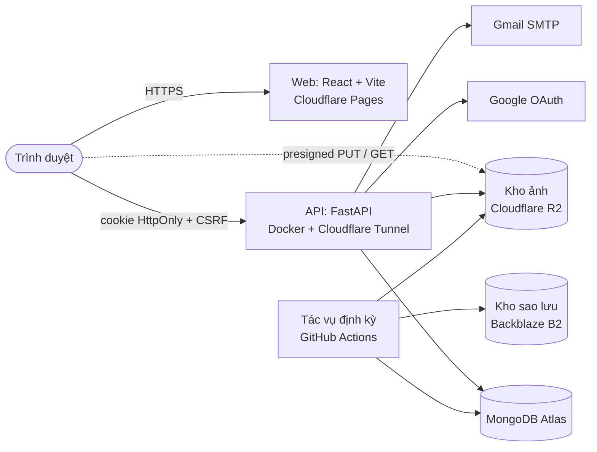

# Jotly

Nhật ký cá nhân trên web. Mỗi ngày một trang, chấm điểm tâm trạng trong một chạm, rồi nhìn lại qua dòng thời gian,
lịch tháng và Year in Pixels.

[](https://github.com/Nha-Cong-Dong/DailyDiary/actions/workflows/ci.yml)
[](LICENSE)

|                  |                                                                               |
| ---------------- | ----------------------------------------------------------------------------- |
| **Sản phẩm**     | <https://jotly.io.vn>                                                         |
| **Phiên bản**    | 1.0 (30/10/2026)                                                              |
| **Tên mã**       | DailyDiary                                                                    |
| **Việc còn lại** | [`docs/Backlog.md`](docs/Backlog.md)                                          |

## Mục lục

1. [Tính năng](#tính-năng)
2. [Kiến trúc](#kiến-trúc)
3. [Công nghệ](#công-nghệ)
4. [Chạy ở máy local](#chạy-ở-máy-local)
5. [Lệnh thường dùng](#lệnh-thường-dùng)
6. [Triển khai](#triển-khai)
7. [Cấu trúc thư mục](#cấu-trúc-thư-mục)
8. [Tài liệu](#tài-liệu)
9. [Quy tắc khi đóng góp](#quy-tắc-khi-đóng-góp)
10. [Giấy phép](#giấy-phép)

## Tính năng

| Tính năng | Mô tả |
| --- | --- |
| Viết nhật ký | Mỗi ngày một trang: điểm 1–5 bằng biểu tượng, biểu tượng phụ, cờ màu, tiêu đề, nội dung, từ khóa. Ghi bù và sửa trang cũ. |
| Tự động lưu | Lưu khi đang gõ, giữ nháp trên máy khi mất mạng, phát hiện xung đột khi sửa ở hai nơi. |
| Ảnh | Tối đa 10 ảnh mỗi ngày, nén trên trình duyệt (bỏ EXIF/GPS), kho ảnh riêng tư, link xem có hạn 1 giờ. |
| Dòng thời gian và lịch tháng | Danh sách theo tháng, nhịp điểm, chuỗi ngày liên tiếp, thống kê tháng, chấm điểm nhanh cho hôm nay. |
| Year in Pixels | Cả năm trên một màn hình, mỗi ngày một ô màu theo điểm hoặc theo cờ. |
| Tìm kiếm | Theo từ khóa, tiêu đề, nội dung (không phân biệt dấu); lọc theo điểm, khoảng thời gian, có ảnh. |
| Chia sẻ một trang | Link chỉ xem, tự chọn phần được hiện, tắt bất cứ lúc nào. |
| Xóa và quyền riêng tư | Thùng rác 30 ngày, xóa toàn bộ dữ liệu, xóa tài khoản; chính sách quyền riêng tư tại `/privacy`. |
| Điện thoại và giao diện tối | Bố cục riêng cho màn hình từ 360 px, chế độ sáng và tối. |
| Vận hành | Hạn mức dung lượng ảnh, giới hạn tần suất, tác vụ dọn dẹp, sao lưu và khôi phục cơ sở dữ liệu và ảnh. |

Đăng nhập bằng Google, không dùng mật khẩu. Người dùng từ 16 tuổi.

## Kiến trúc



- **Riêng tư theo thiết kế.** Mọi truy vấn lọc theo `user_id` lấy từ phiên đăng nhập. Log không bao giờ chứa tiêu đề,
  nội dung, từ khóa hay ảnh.
- **Ảnh không đi qua backend.** Trình duyệt nén ảnh rồi tải thẳng lên kho bằng presigned URL; backend chỉ ký và xác nhận.
- **Giới hạn dùng chung.** Số ảnh, độ dài, rate limit chỉ khai báo ở [`shared/limits.json`](shared/limits.json), được
  cả backend lẫn frontend đọc.

## Công nghệ

| Phần | Công nghệ |
| --- | --- |
| Frontend (`apps/web`) | React 19, Vite 8, TypeScript, TanStack Query 5, React Router 8, Tailwind CSS 4, shadcn/ui (Radix), openapi-fetch |
| Backend (`apps/api`) | Python 3.12 (uv), FastAPI, Pydantic v2, PyMongo async, Authlib, slowapi, boto3 |
| Dữ liệu | MongoDB 8.0; kho S3 (MinIO ở local, Cloudflare R2 ở production); Backblaze B2 cho sao lưu |
| Kiểm thử | pytest + httpx trên MongoDB thật, Vitest + Testing Library, Playwright (máy tính và điện thoại 360 px) |
| Chất lượng | ruff, oxlint, `tsc`, GitHub Actions (lint, test, build, e2e, kiểm tra OpenAPI khớp với code) |

## Chạy ở máy local

### Yêu cầu

| Công cụ | Phiên bản |
| --- | --- |
| [Docker Desktop](https://www.docker.com/products/docker-desktop/) | mới nhất |
| [uv](https://docs.astral.sh/uv/) | mới nhất |
| [Node.js](https://nodejs.org/) | 24 trở lên |
| [Git](https://git-scm.com/) | mới nhất |

### 1. Lấy mã nguồn và bật dịch vụ nền

```powershell
git clone https://github.com/Nha-Cong-Dong/DailyDiary.git
cd DailyDiary
docker compose up -d        # MongoDB, MinIO (kho ảnh và sao lưu), Mailpit
```

### 2. Backend (terminal thứ nhất)

```powershell
cd apps/api
$env:PYTHONUTF8 = "1"                  # bash: export PYTHONUTF8=1
uv python install 3.12
uv sync
Copy-Item .env.example .env            # bash: cp .env.example .env
uv run python -m app.db.migrate
uv run uvicorn app.main:app --reload --port 8000
```

### 3. Frontend (terminal thứ hai)

```powershell
cd apps/web
npm install
npm run dev
```

### 4. Mở ứng dụng

Vào <http://localhost:5173>, chọn **Bắt đầu viết**, rồi **Đăng nhập thử**. Chế độ này không cần tài khoản Google và chỉ
bật ở local (`DEV_LOGIN=true` trong `.env`).

Để đăng nhập bằng Google thật, tạo OAuth client loại "Web application" với redirect URI
`http://localhost:8000/auth/google/callback`, rồi điền `GOOGLE_CLIENT_ID` và `GOOGLE_CLIENT_SECRET` vào `apps/api/.env`.
Mọi biến cấu hình được giải thích trong [`apps/api/.env.example`](apps/api/.env.example).

### Địa chỉ ở máy local

| Dịch vụ | Địa chỉ | Ghi chú |
| --- | --- | --- |
| Web | <http://localhost:5173> | Vite dev server |
| API | <http://localhost:8000> | Tài liệu API: <http://localhost:8000/docs> |
| MongoDB | `localhost:27017` | Tài khoản `dd` / `dd` |
| MinIO console | <http://localhost:9001> | `minioadmin` / `minioadmin`; bucket `dailydiary-photos`, `dailydiary-backups` |
| Mailpit | <http://localhost:8025> | Mọi email gửi ra ở local dừng tại đây |

### Dừng

Nhấn `Ctrl+C` ở hai terminal, rồi chạy `docker compose stop`. Lần sau chỉ cần `docker compose up -d` và lệnh cuối của
bước 2 và bước 3.

## Lệnh thường dùng

### Backend (trong `apps/api`)

| Lệnh | Việc |
| --- | --- |
| `uv run pytest -q` | Toàn bộ test (cần MongoDB; DB `dailydiary_test` bị xóa sạch mỗi lần chạy) |
| `uv run ruff check . && uv run ruff format --check .` | Lint và kiểm tra định dạng |
| `uv run python -m app.db.migrate` | Chạy migration (validator và index); chạy lại an toàn |
| `uv run python -m app.jobs.run <tác vụ>` | Tác vụ vận hành (bảng dưới) |

### Frontend (trong `apps/web`)

| Lệnh | Việc |
| --- | --- |
| `npm run dev` | Dev server ở cổng 5173 |
| `npm test` | Unit test (Vitest) |
| `npm run typecheck`, `npm run lint` | TypeScript, oxlint |
| `npm run build` | Bản build production vào `dist/` |
| `npm run test:e2e` | Playwright; tự bật API và web nếu chưa chạy (cần `docker compose up -d`). Cổng 8000 đã bận (vd. API production trên cùng máy) thì đặt `E2E_API_PORT=8001` |
| `npm run gen:api` | Sinh lại `src/api/openapi.json` và `schema.d.ts` sau khi đổi API (CI báo lỗi nếu lệch) |

### Tác vụ vận hành

| Tác vụ | Lịch | Việc |
| --- | --- | --- |
| `purge_accounts` | mỗi giờ | Dọn hẳn tài khoản đã yêu cầu xóa (DB và ảnh), gửi email xác nhận |
| `purge_trash` | mỗi ngày | Xóa vĩnh viễn trang quá 30 ngày trong thùng rác, kèm ảnh |
| `backup_db` | 00:00, 08:00, 16:00 (giờ Việt Nam) | Sao lưu MongoDB thành `.tar.gz` lên kho sao lưu, giữ `BACKUP_KEEP` bản |
| `backup_photos` | mỗi ngày | Chép tăng dần ảnh sang kho sao lưu; bản sao của ảnh đã xóa giữ tối đa 7 ngày |
| `restore_db --target <db> [--key …] [--force]` | khi cần | Khôi phục vào DB khác; từ chối DB đang chạy |

Mã thoát: `0` thành công hoặc chưa cấu hình, `1` lỗi, `2` sai cú pháp.

Font tự host: trong `apps/web`, chạy
`uv run --no-project --with "fonttools[woff]==4.67.0" python scripts/subset_fonts.py` để tạo lại Commissioner (biến thiên)
và Young Serif đã cắt còn ký tự tiếng Việt và Latin vào `src/assets/fonts/`.

## Triển khai

| Thành phần | Dịch vụ | Địa chỉ |
| --- | --- | --- |
| Web | Cloudflare Pages (Direct Upload) | <https://jotly.io.vn> |
| API | Docker ([`docker-compose.prod.yml`](docker-compose.prod.yml)) sau Cloudflare Tunnel | <https://api.jotly.io.vn> |
| Cơ sở dữ liệu | MongoDB Atlas (Singapore) | |
| Kho ảnh | Cloudflare R2 | |
| Sao lưu | Backblaze B2 | |
| Tác vụ định kỳ | GitHub Actions ([`jobs.yml`](.github/workflows/jobs.yml)) | mỗi giờ |

Quy trình phát hành: merge vào `main` qua PR (CI phải xanh), build lại API bằng
`docker compose -f docker-compose.prod.yml up -d --build` trên máy chạy production, build web với
`VITE_API_URL=https://api.jotly.io.vn` rồi tải `apps/web/dist` lên Pages. Hướng dẫn dựng từ đầu, việc định kỳ và xử lý
sự cố: [`docs/Deploy.md`](docs/Deploy.md).

## Cấu trúc thư mục

```text
DailyDiary/
├── apps/
│   ├── api/                  # FastAPI: routers, services, MongoDB; jobs/ (dọn dẹp, sao lưu); tests/
│   └── web/                  # React + Vite: routes/ ghép từ features/, components/, lib/
├── shared/                   # limits.json, icons.json, flag_colors.json dùng chung cho api và web
├── docs/                     # đặc tả, kế hoạch, triển khai, việc tồn đọng, cây dự án, ADR
├── .github/workflows/        # CI và tác vụ định kỳ
├── docker-compose.yml        # dịch vụ nền ở local
└── docker-compose.prod.yml   # API production
```

Cây đầy đủ và quy ước đặt file: [`docs/Project_Structure.md`](docs/Project_Structure.md) (nguồn duy nhất).

## Tài liệu

| Tài liệu | Nội dung |
| --- | --- |
| [`docs/Project_Specs.md`](docs/Project_Specs.md) | Đặc tả hệ thống hiện tại: màn hình, tính năng, bảo mật, hiệu năng, dữ liệu, API, triển khai |
| [`docs/Backlog.md`](docs/Backlog.md) | Việc chưa làm sau bản 1.0 |
| [`docs/Deploy.md`](docs/Deploy.md) | Triển khai production, việc định kỳ, sự cố thường gặp |
| [`docs/Roadmap.md`](docs/Roadmap.md) | Định hướng: bối cảnh, lộ trình, kiếm tiền, rủi ro, nhật ký quyết định |
| [`docs/MVP_Plan.md`](docs/MVP_Plan.md) | Kế hoạch theo bước và kết quả từng bước |
| [`docs/Project_Structure.md`](docs/Project_Structure.md) | Cây thư mục chuẩn và lịch sử thay đổi |
| [`docs/adr/`](docs/adr/README.md) | Quyết định kiến trúc |
| [`CLAUDE.md`](CLAUDE.md) | Quy tắc làm việc cho trợ lý AI trong repo |

## Quy tắc khi đóng góp

- **Quyền riêng tư.** Mọi truy vấn dữ liệu người dùng lọc theo `user_id` từ phiên. Không đưa nguyên dict từ request vào
  bộ lọc hay lệnh cập nhật MongoDB. Không ghi tiêu đề, nội dung, từ khóa, ảnh vào log.
- **Ngày giờ.** `entry_date` là ngày địa phương của người dùng (`YYYY-MM-DD`); mọi mốc thời gian khác lưu UTC.
- **Giới hạn** chỉ đọc từ `shared/limits.json`, không viết cứng.
- **Đổi API** thì chạy `npm run gen:api` và commit cả `openapi.json` lẫn `schema.d.ts`.
- **Thêm, di chuyển file** theo `docs/Project_Structure.md` và thêm một dòng vào lịch sử thay đổi ở đó.
- **Component shadcn** thêm bằng `npx shadcn@4.22.0 add <tên>`; không cài CLI shadcn vào dự án, không chạy
  `npm audit fix --force`.
- **Commit** theo [Conventional Commits](https://www.conventionalcommits.org/) (`feat:`, `fix:`, `docs:`, `test:`…).
- **Bí mật** chỉ nằm trong file `.env*` (đã bị `.gitignore` chặn), GitHub Secrets hoặc dashboard của dịch vụ.

## Giấy phép

[MIT](LICENSE) © 2026 Nha-Cong-Dong
