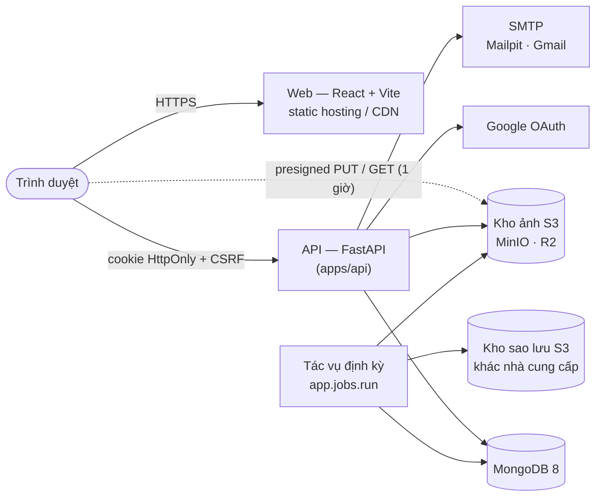

<div align="center">

# 📔 Jotly

**Chạm để ghi chú, mở để nhìn lại.**

Nhật ký cá nhân trên web: mỗi ngày một trang, chấm điểm tâm trạng trong một chạm,
rồi nhìn lại cả năm qua dòng thời gian, lịch tháng và Year in Pixels.

[](https://github.com/Nha-Cong-Dong/DailyDiary/actions/workflows/ci.yml)


[](LICENSE)

</div>

> [!NOTE]
> Jotly (tên mã **DailyDiary**) đang ở giai đoạn **MVP, Bước 14/15**: đủ tính năng nhật ký, đang tối ưu hiệu năng và
> chuẩn bị triển khai bản beta. Tiến độ chi tiết: [`docs/MVP_Plan.md`](docs/MVP_Plan.md).

## Mục lục

- [Tính năng](#-tính-năng)
- [Kiến trúc](#-kiến-trúc)
- [Công nghệ](#-công-nghệ)
- [Chạy ở máy local](#-chạy-ở-máy-local)
- [Lệnh thường dùng](#-lệnh-thường-dùng)
- [Cấu trúc thư mục](#-cấu-trúc-thư-mục)
- [Tài liệu](#-tài-liệu)
- [Quy tắc khi đóng góp](#-quy-tắc-khi-đóng-góp)
- [Giấy phép](#-giấy-phép)

## ✨ Tính năng

| | Tính năng | Mô tả |
| --- | --- | --- |
| ✍️ | **Viết nhật ký** | Mỗi ngày một trang: điểm 1–5 bằng biểu tượng, biểu tượng phụ, cờ màu, tiêu đề, nội dung, từ khóa. Ghi bù và sửa trang cũ. |
| 💾 | **Tự động lưu** | Lưu khi đang gõ, giữ nháp trên máy khi mất mạng, phát hiện xung đột khi sửa ở hai nơi. |
| 🖼️ | **Ảnh** | Tối đa 10 ảnh/ngày, nén ngay trên trình duyệt (bỏ EXIF/GPS), kho ảnh riêng tư, link xem có hạn 1 giờ. |
| 🗓️ | **Dòng thời gian & lịch tháng** | Danh sách theo tháng, nhịp điểm, chuỗi ngày liên tiếp, thống kê tháng; chấm điểm nhanh cho hôm nay. |
| 🟩 | **Year in Pixels** | Cả năm trên một màn, mỗi ngày một ô màu theo điểm hoặc theo cờ. |
| 🔎 | **Tìm kiếm** | Theo từ khóa, tiêu đề, nội dung (không phân biệt dấu), lọc theo điểm, khoảng thời gian, có ảnh. |
| 🔗 | **Chia sẻ một trang** | Link chỉ xem, tự chọn phần được hiện, tắt bất cứ lúc nào. |
| 🗑️ | **Xóa & quyền riêng tư** | Thùng rác 30 ngày, xóa toàn bộ dữ liệu, xóa tài khoản; [chính sách quyền riêng tư](apps/web/src/features/legal/PrivacyPolicy.tsx) tại `/privacy`. |
| 📱 | **Điện thoại & giao diện tối** | Bố cục riêng cho màn hình từ 360 px, chế độ sáng/tối. |
| 🛠️ | **Vận hành** | Hạn mức dung lượng ảnh, giới hạn tần suất, tác vụ dọn dẹp và sao lưu/khôi phục DB + ảnh. |

Đăng nhập bằng Google (không mật khẩu). Thiết kế giao diện: hệ "Mực & giấy · Sổ tay · Sổ dán".

## 🧭 Kiến trúc



- **Riêng tư theo thiết kế:** mọi truy vấn lọc theo `user_id` lấy từ phiên đăng nhập; log và công cụ lỗi không bao giờ
  chứa tiêu đề, nội dung, từ khóa hay ảnh.
- **Ảnh không đi qua backend:** trình duyệt nén rồi tải thẳng lên kho bằng presigned URL; backend chỉ ký và xác nhận.
- **Giới hạn dùng chung:** số ảnh, độ dài, rate limit… chỉ khai báo ở [`shared/limits.json`](shared/limits.json), đọc
  bởi cả backend lẫn frontend.

## 🧰 Công nghệ

| Phần | Công nghệ |
| --- | --- |
| **Frontend** (`apps/web`) | React 19, Vite 8, TypeScript, TanStack Query 5, React Router 8, Tailwind CSS 4 + shadcn/ui (Radix), openapi-fetch |
| **Backend** (`apps/api`) | Python 3.12 (uv), FastAPI, Pydantic v2, PyMongo async, Authlib (Google OAuth), slowapi, boto3 |
| **Dữ liệu** | MongoDB 8.0, kho S3 (MinIO ở local; Cloudflare R2/Supabase khi triển khai), Backblaze B2 cho sao lưu |
| **Kiểm thử** | pytest + httpx (MongoDB thật), Vitest + Testing Library, Playwright (máy tính + điện thoại 360 px) |
| **Chất lượng** | ruff, oxlint, `tsc`, GitHub Actions (lint, test, build, e2e, kiểm tra OpenAPI khớp) |

## 🚀 Chạy ở máy local

### Yêu cầu

| Công cụ | Phiên bản | Cài đặt |
| --- | --- | --- |
| Docker Desktop | mới | <https://www.docker.com/products/docker-desktop/> |
| uv | mới | `powershell -c "irm https://astral.sh/uv/install.ps1 \| iex"` |
| Node.js | 24 trở lên | <https://nodejs.org/> |
| Git | mới | <https://git-scm.com/> |

### 1 · Lấy mã nguồn và bật dịch vụ nền

```powershell
git clone https://github.com/Nha-Cong-Dong/DailyDiary.git
cd DailyDiary
docker compose up -d        # MongoDB, MinIO (kho ảnh + sao lưu), Mailpit
```

### 2 · Backend (cửa sổ terminal thứ nhất)

```powershell
cd apps/api
$env:PYTHONUTF8 = "1"                  # bash: export PYTHONUTF8=1
uv python install 3.12
uv sync
Copy-Item .env.example .env            # bash: cp .env.example .env
uv run python -m app.db.migrate
uv run uvicorn app.main:app --reload --port 8000
```

### 3 · Frontend (cửa sổ terminal thứ hai)

```powershell
cd apps/web
npm install
npm run dev
```

### 4 · Mở ứng dụng

Vào <http://localhost:5173> → **Bắt đầu viết** → **Đăng nhập thử** (không cần tài khoản Google, nhờ `DEV_LOGIN=true`
trong `.env`).

> [!TIP]
> Muốn đăng nhập bằng Google thật: tạo OAuth client "Web application" ở Google Cloud Console với redirect URI
> `http://localhost:8000/auth/google/callback`, rồi điền `GOOGLE_CLIENT_ID` / `GOOGLE_CLIENT_SECRET` vào
> `apps/api/.env`. Mọi biến cấu hình được giải thích ngay trong [`apps/api/.env.example`](apps/api/.env.example).

### Địa chỉ ở máy local

| Dịch vụ | Địa chỉ | Ghi chú |
| --- | --- | --- |
| Web app | <http://localhost:5173> | Vite dev server |
| API | <http://localhost:8000> | tài liệu API tự sinh: <http://localhost:8000/docs> |
| MongoDB | `localhost:27017` | tài khoản `dd` / `dd` |
| MinIO console | <http://localhost:9001> | `minioadmin` / `minioadmin`; bucket `dailydiary-photos`, `dailydiary-backups` |
| Mailpit | <http://localhost:8025> | mọi email gửi ra (góp ý, xác nhận xóa tài khoản) dừng ở đây |

### Dừng

`Ctrl+C` ở hai terminal, rồi `docker compose stop`. Lần sau: `docker compose up -d` và lệnh cuối của bước 2, 3.

## 📋 Lệnh thường dùng

<details open>
<summary><b>Backend</b> — chạy trong <code>apps/api</code></summary>

| Lệnh | Việc |
| --- | --- |
| `uv run pytest -q` | Toàn bộ test (cần MongoDB; DB `dailydiary_test` bị xóa sạch mỗi lần chạy) |
| `uv run ruff check . && uv run ruff format --check .` | Lint và kiểm tra định dạng |
| `uv run python -m app.db.migrate` | Chạy migration (validator + index), chạy lại an toàn |
| `uv run python -m app.jobs.run <tác vụ>` | Tác vụ vận hành, xem bảng dưới |

</details>

<details open>
<summary><b>Frontend</b> — chạy trong <code>apps/web</code></summary>

| Lệnh | Việc |
| --- | --- |
| `npm run dev` | Dev server ở cổng 5173 |
| `npm test` | Unit test (Vitest) |
| `npm run typecheck` · `npm run lint` | TypeScript · oxlint |
| `npm run build` | Bản build production vào `dist/` |
| `npm run test:e2e` | Playwright, tự bật API + web nếu chưa chạy (cần `docker compose up -d`) |
| `npm run gen:api` | Sinh lại `src/api/openapi.json` + `schema.d.ts` sau khi đổi API (CI báo lỗi nếu lệch) |

</details>

<details>
<summary><b>Tác vụ vận hành</b> — <code>uv run python -m app.jobs.run …</code></summary>

| Tác vụ | Lịch đề xuất | Việc |
| --- | --- | --- |
| `purge_accounts` | mỗi giờ | Dọn hẳn tài khoản đã yêu cầu xóa (DB + ảnh), gửi email xác nhận |
| `purge_trash` | mỗi ngày | Xóa vĩnh viễn trang quá 30 ngày trong thùng rác, kèm ảnh |
| `backup_db` | 00:00, 08:00, 16:00 (giờ VN) | Sao lưu MongoDB thành `.tar.gz` lên kho sao lưu, giữ `BACKUP_KEEP` bản |
| `backup_photos` | mỗi ngày | Chép tăng dần ảnh sang kho sao lưu; bản sao của ảnh đã xóa giữ tối đa 7 ngày |
| `restore_db --target <db> [--key …] [--force]` | khi cần | Khôi phục vào DB khác; từ chối DB đang chạy |

Mã thoát: `0` ổn hoặc chưa cấu hình · `1` lỗi · `2` sai cú pháp.

</details>

<details>
<summary><b>Font tự host</b></summary>

`uv run --no-project --with "fonttools[woff]==4.67.0" python scripts/subset_fonts.py` (trong `apps/web`) tạo lại Be
Vietnam Pro và Young Serif đã cắt còn ký tự tiếng Việt + Latin vào `src/assets/fonts/`.

</details>

## 🗂️ Cấu trúc thư mục

```text
DailyDiary/
├── apps/
│   ├── api/          # FastAPI: routers → services → MongoDB; jobs/ (dọn dẹp, sao lưu); tests/
│   └── web/          # React + Vite: routes/ (màn) ghép từ features/ (tính năng), components/, lib/
├── shared/           # limits.json, icons.json, flag_colors.json — dùng chung cho api và web
├── docs/             # đặc tả, kế hoạch MVP, cây dự án chuẩn, ADR
├── .github/workflows # CI
└── docker-compose.yml
```

Cây đầy đủ và quy ước đặt file là **nguồn duy nhất** ở [`docs/Project_Structure.md`](docs/Project_Structure.md).

## 📚 Tài liệu

| Tài liệu | Nội dung |
| --- | --- |
| [`docs/Project_Specs.md`](docs/Project_Specs.md) | Đặc tả sản phẩm: tính năng, yêu cầu bảo mật/hiệu năng, mô hình dữ liệu |
| [`docs/MVP_Plan.md`](docs/MVP_Plan.md) | Kế hoạch 15 bước và kết quả từng bước |
| [`docs/Project_Structure.md`](docs/Project_Structure.md) | Cây thư mục chuẩn và lịch sử thay đổi |
| [`docs/adr/`](docs/adr/README.md) | Các quyết định kiến trúc (MongoDB, phiên trong DB, chia sẻ trong MVP…) |
| [`CLAUDE.md`](CLAUDE.md) | Quy tắc làm việc cho trợ lý AI trong repo |

## 🤝 Quy tắc khi đóng góp

- **Quyền riêng tư là bắt buộc:** mọi truy vấn dữ liệu người dùng lọc theo `user_id` từ phiên; không đưa nguyên dict từ
  request vào bộ lọc MongoDB; không ghi tiêu đề, nội dung, từ khóa, ảnh vào log.
- **Ngày giờ:** `entry_date` là ngày địa phương của người dùng (`YYYY-MM-DD`); mọi mốc thời gian khác lưu UTC.
- **Giới hạn** chỉ đọc từ `shared/limits.json`, không viết cứng.
- **Đổi API** thì chạy `npm run gen:api` và commit cả `openapi.json` lẫn `schema.d.ts`.
- **Thêm/di chuyển file** thì theo `docs/Project_Structure.md` và thêm một dòng lịch sử ở đó.
- **Component shadcn:** `npx shadcn@4.22.0 add <tên>`; không cài CLI shadcn vào dự án, không `npm audit fix --force`.
- **Commit** theo [Conventional Commits](https://www.conventionalcommits.org/) (`feat:`, `fix:`, `docs:`, `test:`…).
- **Bí mật** chỉ nằm trong `.env` (đã bị `.gitignore`) hoặc biến môi trường của hosting.

## 📄 Giấy phép

[MIT](LICENSE) © 2026 Nha-Cong-Dong
