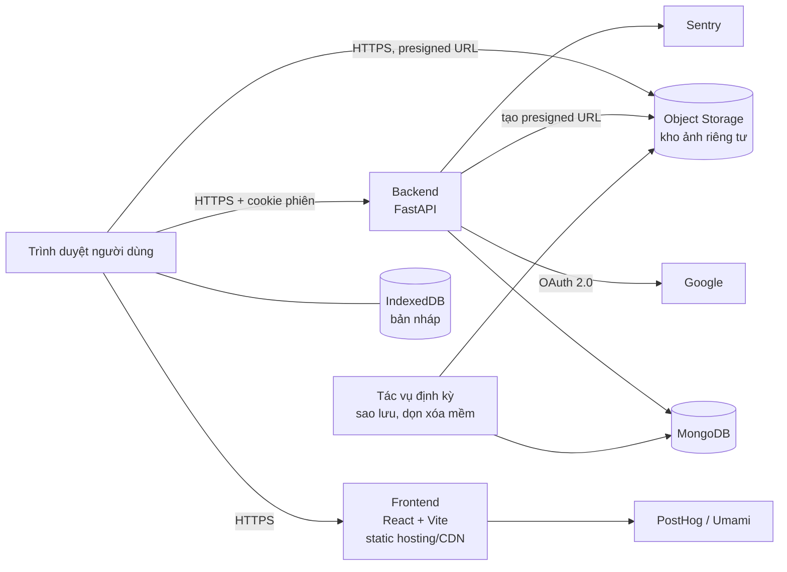

# DailyDiary – Tài liệu đặc tả kỹ thuật

|                       |                                                           |
| --------------------- | --------------------------------------------------------- |
| **Phiên bản**         | 0.1 (bản nháp)                                            |
| **Ngày cập nhật**     | 16/10/2026                                                |
| **Phạm vi**           | Giai đoạn 1 – MVP (web app), kèm định hướng giai đoạn 2–3 |
| **Quy mô thử nghiệm** | Dưới 20 người dùng                                        |
| **Thời gian MVP**     | 2 tuần                                                    |

---

## 1. Tổng quan dự án

### 1.1. Vấn đề

Nhiều người có thói quen ghi lại cuộc sống của mình: viết nhật ký, lưu ảnh, trang trí sổ. Song song đó, ngày càng nhiều người muốn thay thế các nguồn "dopamine nhanh" (mạng xã hội, video ngắn) bằng các nguồn dopamine lành mạnh hơn như tập luyện, học tập, rèn thói quen tốt. Điểm chung là cảm giác tiến bộ khi nhìn lại hành trình của bản thân.

Tuy nhiên, sổ giấy khó mang theo, khó tìm lại, dễ thất lạc. Các ứng dụng ghi chú thông thường lại khô khan và không giúp người dùng thấy sự thay đổi của mình theo thời gian.

### 1.2. Giải pháp

**DailyDiary** là ứng dụng nhật ký giúp người dùng ghi lại suy nghĩ, tâm trạng và hình ảnh mỗi ngày: tiện lợi, trực quan, dễ chịu khi nhìn lại tiến trình, sự phát triển và biến động tâm trạng của chính mình.

### 1.3. Mục tiêu của MVP

MVP chứng minh một điều duy nhất: **ghi lại mỗi ngày thật dễ, và nhìn lại thì thấy vui.**

Mục tiêu cụ thể:
- Có web app chạy thật, người dùng thử truy cập được qua một đường link.
- Người dùng ghi được một ngày trong vài giây (chỉ cần chọn biểu tượng chấm điểm).
- Người dùng nhìn lại được hành trình qua dòng thời gian, lịch tháng và Year in Pixels.
- Thu thập dữ liệu sử dụng và góp ý để quyết định hướng phát triển.

### 1.4. Chỉ số thành công (tiêu chí chuyển sang giai đoạn 2)

| Chỉ số                                                          | Cách đo                                   |
| --------------------------------------------------------------- | ----------------------------------------- |
| Tỉ lệ người dùng còn hoạt động sau 7 ngày (D7) và 30 ngày (D30) | Sự kiện đăng nhập / tạo bài viết          |
| Số ngày được ghi trung bình mỗi tuần / người                    | Collection `entries`                      |
| Tỉ lệ bài ghi "đúng ngày" so với "cập nhật muộn"                | So sánh `updated_at` với `entry_date`     |
| Thiết bị người dùng thường dùng để ghi                          | Phân tích sự kiện (máy tính / điện thoại) |
| Mức sẵn sàng giới thiệu cho người khác (NPS)                    | Khảo sát sau 2–4 tuần                     |

### 1.5. Đối tượng người dùng

- Người muốn viết nhật ký, lưu lại kỷ niệm trên thiết bị của mình.
- Người đang viết nhật ký giấy, muốn chuyển sang hoặc kết hợp thêm dạng số.
- Người yêu thích trang trí sổ (bullet journal, scrapbook).
- Người đang xây dựng lối sống lành mạnh hơn và muốn nhìn thấy sự tiến bộ.
- Học sinh, sinh viên muốn lưu lại hành trình học tập, ôn thi, du học.
- Người quan tâm sức khỏe tinh thần, muốn theo dõi tâm trạng.
- Cặp đôi, nhóm bạn, gia đình muốn lưu giữ kỷ niệm chung *(giai đoạn sau)*.
- Cha mẹ muốn ghi lại quá trình lớn lên của con.
- Người thích du lịch muốn lưu hành trình bằng chữ và ảnh.
- Người đang trải qua giai đoạn thay đổi lớn trong cuộc sống.

---

## 2. Phạm vi MVP

### 2.1. Trong phạm vi

- Trải nghiệm **cá nhân**: một người dùng, nhật ký riêng.
- Nền tảng: **web app**, ưu tiên trình duyệt trên máy tính (Chrome, Edge); giao diện responsive để dùng được trên điện thoại. Luồng "ghi nhanh" (chọn biểu tượng, thêm ảnh) phải mượt trên điện thoại.
- Đăng nhập bằng tài khoản Google.
- Chia sẻ **một trang** qua link chỉ xem, người viết chọn phần được hiện (F-10, ADR 0005, chốt 21/10/2026).

### 2.2. Ngoài phạm vi MVP

- Tính năng nhiều người dùng: nhật ký chung, bình luận, theo dõi người khác. (Chia sẻ một trang qua link đã vào MVP, xem F-10.)
- Đăng nhập Facebook và các nhà cung cấp khác.
- Đổi chủ đề, theme, trang trí, sticker.
- AI, video tổng kết, thông báo đẩy.
- Ứng dụng desktop, ứng dụng di động.
- Thanh toán, tiền ảo.

---

## 3. Danh sách tính năng

Ký hiệu mức ưu tiên: **P0** bắt buộc · **P1** nên có nếu kịp · **P2** để giai đoạn sau.

| Mã   | Tính năng                                  | Ưu tiên      |
| ---- | ------------------------------------------ | ------------ |
| F-01 | Viết nhật ký trong ngày                    | P0           |
| F-02 | Dòng thời gian, lịch tháng, thống kê tháng | P0           |
| F-03 | Year in Pixels                             | P0           |
| F-04 | Đăng nhập Google, hồ sơ người dùng         | P0           |
| F-05 | Tìm kiếm theo từ khóa                      | P0           |
| F-06 | Tự động lưu, trạng thái đồng bộ            | P0           |
| F-07 | Xóa toàn bộ dữ liệu, xóa tài khoản         | P1 (đề xuất) |
| F-08 | ~~Xuất dữ liệu (JSON)~~ bỏ (21/10/2026)    | –            |
| F-09 | Nút góp ý trong app                        | P1 (đề xuất) |
| F-10 | Chia sẻ một trang qua link chỉ xem         | P1           |

### F-01. Viết nhật ký trong ngày

Mỗi người dùng có tối đa **1 nhật ký cho mỗi ngày**. Mỗi nhật ký gồm:

| Trường                       | Bắt buộc | Thông số                                                            |
| ---------------------------- | -------- | ------------------------------------------------------------------- |
| Tiêu đề                      | Không    | 0–100 ký tự                                                         |
| Nội dung                     | Không    | 0–20.000 ký tự, văn bản thuần, chuẩn hóa Unicode NFC                |
| Từ khóa                      | Không    | 0–10 từ khóa, mỗi từ 1–30 ký tự, không trùng lặp                    |
| Cờ hiệu                      | Không    | 1 màu: từ bảng 8 màu có sẵn hoặc màu tùy chỉnh người dùng thêm qua bảng pha màu (lưu mã hex `#RRGGBB`); có lựa chọn "không cờ" |
| Ảnh                          | Không    | 0–10 ảnh/ngày                                                       |
| Biểu tượng chính (main icon) | **Có**   | Điểm số nguyên 1–5; hình vẽ theo bộ icon trong hồ sơ (MVP có 6 bộ)  |
| Biểu tượng con (sub icon)    | Không    | 0–1 emoji, chọn từ danh sách khoảng 30–50 emoji gợi ý               |

Quy tắc:
- **Điều kiện "đã ghi"**: đã chọn biểu tượng chính. Mọi trường khác là tùy chọn, giúp giữ chân người dùng khi họ nhất thời chán nản.
- **Ngày được phép ghi**: hôm nay và các ngày trước; không cho ghi ngày tương lai. "Ngày" tính theo múi giờ của người dùng.
- **Thời gian khởi tạo và sửa cuối** được lưu lại. Bài có lần sửa cuối nằm trong chính ngày đó hiện nhãn **"ghi đúng ngày"**; ngược lại hiện **"cập nhật muộn"**, nhằm khuyến khích người dùng ghi ngay trong ngày.
- **Sửa, xóa**: cho phép. Xóa cần xác nhận và là **xóa mềm**, khôi phục được trong 30 ngày (`entry.restore_days` trong
  `shared/limits.json`). Ghi lại vào một ngày đã xóa mềm tạo trang mới thay cho bản đã xóa.
- **Hiển thị biểu tượng**: sub icon hiển thị nhỏ cạnh main icon, tỉ lệ kích thước sub/main khoảng 0,5–0,6 (đặt thành biến giao diện để dễ điều chỉnh).

Ảnh:
- Định dạng nhận vào: JPEG, PNG, HEIC, WebP; tối đa 10 MB/ảnh gốc (chốt theo thiết kế B9, 21/10/2026). HEIC được
  chuyển sang WebP ngay trên trình duyệt trước khi nén (thư viện giải mã HEIC chạy WebAssembly, Bước 7).
- Nén trên trình duyệt trước khi tải lên: cạnh dài tối đa 1920 px, WebP chất lượng khoảng 80% (khoảng 300–500 KB).
- Tạo ảnh thu nhỏ cạnh dài khoảng 320 px cho dòng thời gian và lịch.
- Không lưu ảnh gốc ở MVP; thông báo cho người dùng biết ảnh gốc vẫn nằm trên máy của họ.

### F-02. Dòng thời gian, lịch tháng, thống kê tháng

- **Danh sách bài theo tháng** (thiết kế B8, đổi 21/10/2026 thay cho cuộn vô hạn): xem từng tháng, mới nhất ở trên,
  hiện 7 trang rồi "Xem thêm"; cả tháng lấy trong 1 request, mỗi trang chỉ có đoạn đầu nội dung (300 ký tự) và số ảnh.
- **Lịch tháng**: mỗi ngày hiển thị main icon và sub icon thu nhỏ. Dữ liệu cả tháng lấy trong **1 request**, chỉ gồm ngày, điểm, sub icon, màu cờ (bộ icon lấy từ hồ sơ, áp cho mọi ngày); không tải nội dung bài viết.
- **Thống kê tháng**: số ngày đã ghi / tổng số ngày; điểm trung bình; phân bố điểm 1–5; tổng số ảnh; chuỗi ngày ghi liên tiếp dài nhất; biểu đồ điểm theo ngày.
- **Ghi bù** (thiết kế B9, 21/10/2026): trang tạo sau khi ngày đó đã qua (`created_at` rơi vào ngày sau `entry_date`
  theo múi giờ người dùng) vẫn tô màu trong lịch tháng và Year in Pixels, nhưng **không nối lại chuỗi ngày liên tiếp**.
- Thời gian tải lịch + thống kê: dưới 1 giây.

### F-03. Year in Pixels

- Lưới 365/366 ô sắp theo 12 tháng, mỗi ô tô màu theo điểm 1–5; ngày chưa ghi dùng màu trung tính.
- Dữ liệu cả năm lấy trong **1 request** (chỉ ngày + điểm + màu cờ, vài KB): điểm là chuỗi 365/366 ký tự ("0" = chưa
  ghi), cờ và ngày ghi bù chỉ liệt kê ngày có; cả năm ghi đủ, ngày nào cũng có cờ vẫn dưới 10 KB.
- Rê chuột để xem nhanh, bấm để mở nhật ký ngày đó.
- Chọn năm: chỉ các năm có dữ liệu.
- Chế độ tô màu theo cờ hiệu: người dùng chọn "Tô ô theo: Điểm | Cờ hiệu"; lựa chọn nhớ trên trình duyệt.

### F-04. Đăng nhập và hồ sơ

- Đăng nhập bằng Google (OAuth 2.0). Trong giai đoạn thử nghiệm, để OAuth ở chế độ **Testing** và thêm email người dùng thử vào danh sách.
- Phiên đăng nhập 30 ngày, tự làm mới.
- Hồ sơ gồm:

| Trường         | Hiển thị | Thông số                                                                                                                                                                         |
| -------------- | -------- | -------------------------------------------------------------------------------------------------------------------------------------------------------------------------------- |
| Ảnh đại diện   | Có       | Mặc định lấy từ Google; cho đổi và gỡ: JPEG/PNG/WebP, tối đa 2 MB, cắt vuông 256×256 px (giới hạn ở `limits.json` mục `profile`). Làm cùng Bước 7 (kho ảnh) |
| Tên người dùng | Có       | 1–50 ký tự, mặc định lấy từ Google                                                                                                                                               |
| Múi giờ        | Không    | Định dạng IANA (vd: `Asia/Ho_Chi_Minh`), tự nhận từ trình duyệt khi đăng ký, cho phép sửa. Dùng để xác định thời điểm kết thúc ngày. Đổi múi giờ chỉ áp dụng cho các ngày sau đó |
| Bộ icon        | Không    | Mã bộ main icon trong `shared/icons.json` (vd: `sprout`), chọn ở bước 2 lần đầu sử dụng, đổi được trong hồ sơ. Áp dụng cho **mọi ngày**, kể cả ngày đã ghi: đổi bộ chỉ thay hình, điểm giữ nguyên (chốt 20/10/2026) |
| Chế độ màu, ngôn ngữ | Không | Sáng / Tối / Theo hệ thống, lưu trên trình duyệt. MVP chỉ có tiếng Việt; ô chọn English hiện khóa "Sắp có" |

### F-05. Tìm kiếm

- Phạm vi: tiêu đề, nội dung và từ khóa (chốt theo thiết kế B7, 20/10/2026).
- Khớp **chuỗi con**, không phân biệt hoa thường. Gõ **không dấu** thì so không dấu (`da lat` khớp `Đà Lạt`);
  gõ **có dấu** thì so đúng dấu (`mưa` không khớp `mua`).
- Bộ lọc kết hợp: điểm (chọn nhiều mức), khoảng thời gian (tháng này / 3 tháng / năm nay / mọi lúc, mặc định
  mọi lúc để tìm được cả trang của năm trước), chỉ ngày có ảnh. Khoảng thời gian tính theo múi giờ người dùng.
- Kết quả hiện tiêu đề và một đoạn trích quanh chỗ khớp, tô sáng phần khớp; kèm "Từ khóa hay dùng" (6 từ khóa
  dùng nhiều nhất của chính người dùng).
- Từ khóa tìm kiếm không đưa lên URL, không ghi log, không gửi Sentry (là nội dung nhật ký).
- 20–50 kết quả/trang, mới nhất trước. Thời gian phản hồi dưới 500 ms.

### F-06. Tự động lưu

- Lưu nháp vào IndexedDB của trình duyệt sau 1 giây ngừng gõ.
- Đồng bộ lên máy chủ sau 3–5 giây ngừng gõ, khi rời trang hoặc chuyển tab; chỉ gửi khi nội dung thay đổi.
- Hiển thị 3 trạng thái: **Đang lưu / Đã lưu / Chưa đồng bộ (mất mạng)**.
- Khi lỗi: tự thử lại với thời gian chờ tăng dần (2, 4, 8... giây); cảnh báo khi đóng tab còn dữ liệu chưa đồng bộ.
- Mở cùng nhật ký ở 2 tab: gửi kèm thời gian sửa cuối; nếu máy chủ có bản mới hơn thì báo người dùng thay vì ghi đè.

### F-07 – F-09. Tính năng đề xuất bổ sung

- **Xóa toàn bộ dữ liệu** (thiết kế B7/B10-Profile): xóa vĩnh viễn mọi trang, điểm, ảnh và link chia sẻ; giữ tài khoản,
  hồ sơ và cài đặt để viết tiếp. Xác nhận bằng gõ "XÓA".
- **Xóa tài khoản**: xóa toàn bộ nhật ký, ảnh, link chia sẻ, hồ sơ và phiên đăng nhập; đăng xuất ngay. Xác nhận bằng
  gõ đúng email của tài khoản. Tài khoản Google không bị ảnh hưởng.
- ~~**Xuất dữ liệu**~~: bỏ khỏi sản phẩm theo thiết kế (21/10/2026); Hồ sơ ghi rõ "Jotly không có tính năng xuất dữ liệu".
- **Góp ý**: form ngắn trong app, lưu vào collection `feedback`.

### F-10. Chia sẻ một trang (ADR 0005, thiết kế B8)

- Từ trang chi tiết một ngày, người viết bật **link chia sẻ**. Mỗi ngày tối đa một link đang bật; người nhận chỉ xem,
  không sửa, không cần đăng nhập.
- Người viết chọn từng phần được hiện: tên của mình, điểm & icon chính, sub icon, màu cờ, tiêu đề, nội dung, từ khóa,
  từng ảnh. **Ngày viết luôn hiện.** Phải bật ít nhất một phần ngoài ngày viết thì mới sao chép được link.
  Thay đổi lưu ngay; người nhận thấy bản mới khi mở lại link.
- **Tắt link** là thu hồi: link cũ không mở được nữa; bật lại tạo link mới. Màn "Trang đang chia sẻ" (từ Hồ sơ) liệt kê
  các link đang bật, cho sao chép, chỉnh phần chia sẻ, tắt link.
- Trang bị xóa mềm, link đã tắt, token sai hoặc tài khoản đã xóa: người nhận thấy cùng một màn "Trang này không mở
  được", không phân biệt lý do.
- Trang công khai: rate limit theo IP (`shared/limits.json`), không cho lập chỉ mục (`noindex`), không lưu cache,
  không gửi Referer; không lộ email, `user_id` hay id nội bộ. Ảnh dùng link ký có hạn như trong app (Bước 7).
- Token không ghi vào log, Sentry, analytics.

---

## 4. Yêu cầu phi tính năng

### 4.1. Bảo mật và quyền riêng tư

| Yêu cầu             | Thông số                                                                                                                                                                                                                               |
| ------------------- | -------------------------------------------------------------------------------------------------------------------------------------------------------------------------------------------------------------------------------------- |
| Kết nối             | HTTPS bắt buộc, TLS 1.2 trở lên, bật HSTS                                                                                                                                                                                              |
| Phân quyền          | Mỗi người chỉ đọc/ghi/sửa/xóa dữ liệu của mình. Mọi truy vấn ở backend đều lọc theo `user_id` lấy từ phiên đăng nhập, không lấy từ tham số người dùng gửi lên. Có test truy cập chéo tài khoản cho mọi endpoint |
| Ảnh                 | Kho ảnh riêng tư; truy cập bằng link có thời hạn khoảng 1 giờ                                                                                                                                                                          |
| Phiên đăng nhập     | Lưu trong cookie `HttpOnly`, `Secure`, `SameSite=Lax`; có chống CSRF cho các request ghi                                                                                                                                               |
| Log                 | Chỉ ghi mã người dùng, API, mã trạng thái, thời gian xử lý. **Không ghi** tiêu đề, nội dung, từ khóa, ảnh. Giữ log 14–30 ngày                                                                                                          |
| Công cụ bắt lỗi     | Lọc bỏ nội dung nhật ký khỏi dữ liệu gửi về                                                                                                                                                                                            |
| Kiểm thử phân quyền | Dùng tài khoản A gọi API lấy/sửa dữ liệu của B phải bị từ chối                                                                                                                                                                         |
| Pháp lý             | Có trang chính sách quyền riêng tư ngắn gọn. Trước khi ra mắt công khai, rà soát quy định bảo vệ dữ liệu cá nhân của Việt Nam                                                                                                          |
| Quản trị máy chủ    | Nếu dùng SSH: chỉ đăng nhập bằng SSH key, tắt đăng nhập root, không đưa private key lên repo                                                                                                                                           |

### 4.2. Toàn vẹn dữ liệu

| Yêu cầu                   | Thông số                                                                              |
| ------------------------- | ------------------------------------------------------------------------------------- |
| Sao lưu cơ sở dữ liệu     | Mỗi 8 tiếng theo giờ cố định của hệ thống: 00:00, 08:00, 16:00 giờ Việt Nam           |
| Thời gian giữ bản sao lưu | 7 ngày (21 bản)                                                                       |
| Sao lưu ảnh               | Sao chép định kỳ sang nơi lưu trữ khác (sao lưu cơ sở dữ liệu không bao gồm file ảnh) |
| Kiểm tra khôi phục        | Thử khôi phục ít nhất 1 lần trước khi mời người dùng                                  |
| Múi giờ                   | `entry_date` là ngày địa phương của người dùng; mọi mốc thời gian khác lưu dạng UTC   |
| Xóa mềm                   | Bài xóa giữ 30 ngày rồi mới xóa hẳn (kèm ảnh)                                         |

### 4.3. Hiệu năng

| Chỉ số                   | Mục tiêu                         |
| ------------------------ | -------------------------------- |
| API đọc/ghi nhật ký      | p95 dưới 500 ms                  |
| Tải trang (LCP)          | Dưới 2,5 giây                    |
| Phản hồi tương tác (INP) | Dưới 200 ms                      |
| Độ ổn định bố cục (CLS)  | Dưới 0,1                         |
| Tải lên 1 ảnh đã nén     | Dưới 5 giây với mạng bình thường |
| Thời gian hoạt động      | Khoảng 99%                       |

### 4.4. Giới hạn tần suất (rate limit)

| Loại thao tác       | Giới hạn                       |
| ------------------- | ------------------------------ |
| Đồng bộ tự động lưu | 15–20 request/phút/người       |
| Đọc dữ liệu         | 30 request/phút/người          |
| Tạo/xóa nhật ký     | 10 request/phút/người          |
| Tải ảnh lên         | 10 lần/phút, 50 lần/ngày/người |
| Đăng nhập           | 5 lần/phút/IP                  |
| Đọc hồ sơ (`GET /me`) | 120 request/phút/người       |
| Mở trang chia sẻ công khai (F-10) | 60 lần/phút/IP   |

Các con số là mức trần chống lạm dụng, không phải mức sử dụng dự kiến. Điều chỉnh sau tuần thử nghiệm đầu tiên dựa trên log.

### 4.5. Dung lượng

| Hạng mục                     | Thông số                                                |
| ---------------------------- | ------------------------------------------------------- |
| Hạn mức mỗi người dùng       | 500 MB trong giai đoạn thử nghiệm; cảnh báo khi đạt 80% |
| Ước tính trường hợp xấu nhất | 10 ảnh × 0,5 MB × 365 ngày ≈ 1,8 GB/người/năm           |

Theo dõi tổng dung lượng ảnh hằng tuần và đối chiếu với giới hạn gói dịch vụ đang dùng.

### 4.6. Tương thích

- Bản mới của Chrome, Edge, Firefox, Safari trên máy tính.
- Responsive cho màn hình điện thoại (từ 360 px).
- Phông chữ hỗ trợ tốt tiếng Việt có dấu (vd: Be Vietnam Pro).

### 4.7. Theo dõi và đo lường

- Bắt lỗi: Sentry (frontend và backend).
- Phân tích hành vi ở mức sự kiện, không thu thập nội dung: PostHog hoặc Umami. Sự kiện chính: `login`, `entry_created`, `entry_updated`, `photo_uploaded`, `calendar_viewed`, `pixels_viewed`, `search_used`.

---

## 5. Kiến trúc hệ thống

### 5.1. Sơ đồ tổng thể



### 5.2. Công nghệ sử dụng

**Frontend**

| Thành phần            | Công nghệ                                                  |
| --------------------- | ---------------------------------------------------------- |
| Ngôn ngữ, framework   | TypeScript, React, Vite                                    |
| Định tuyến            | React Router                                               |
| Gọi API, bộ nhớ đệm   | TanStack Query                                             |
| Giao diện             | Tailwind CSS, shadcn/ui, biểu tượng Lucide                 |
| Xử lý ngày, múi giờ   | date-fns + date-fns-tz                                     |
| Nén ảnh               | browser-image-compression                                  |
| Lưu nháp              | IndexedDB (thư viện `idb`)                                 |
| Biểu đồ               | Recharts                                                   |
| Kiểm tra dữ liệu form | Zod                                                        |
| Kiểu dữ liệu API      | Sinh tự động từ OpenAPI của FastAPI (`openapi-typescript`) |

**Backend**

| Thành phần                | Công nghệ                                                |
| ------------------------- | -------------------------------------------------------- |
| Ngôn ngữ, framework       | Python 3.12, FastAPI, Uvicorn                            |
| Kiểm tra dữ liệu          | Pydantic v2                                              |
| Cơ sở dữ liệu, migration  | PyMongo async (driver chính thức), migration tự viết `app.db.migrate` |
| Đăng nhập Google          | Authlib (OAuth 2.0 Authorization Code)                   |
| Rate limit                | slowapi                                                  |
| Kho ảnh                   | boto3 (giao thức tương thích S3), tạo presigned URL      |
| Kiểm tra ảnh phía server  | Kiểm tra ảnh đã tải lên kho: tồn tại, định dạng (magic bytes), dung lượng. Không xử lý ảnh; ảnh thu nhỏ tạo trên trình duyệt (MVP không dùng Pillow) |
| Kiểm thử, chất lượng code | pytest, ruff                                             |

**Hạ tầng**

| Thành phần            | Lựa chọn đề xuất                                                        |
| --------------------- | ----------------------------------------------------------------------- |
| Cơ sở dữ liệu         | MongoDB 8.0 có quản lý (vd: MongoDB Atlas, Singapore); gói phải có sao lưu tự động, nếu không thì tự chạy `mongodump` |
| Kho ảnh               | Object storage tương thích S3 (vd: Supabase Storage, Cloudflare R2)     |
| Hosting frontend      | Vercel, Netlify hoặc Cloudflare Pages                                   |
| Hosting backend       | Render, Railway hoặc Fly.io                                             |
| Khu vực máy chủ       | Singapore (gần Việt Nam)                                                |
| Môi trường phát triển | Windows, uv, Docker Compose (MongoDB + MinIO giả lập S3)                |
| CI                    | GitHub Actions: lint, test, build                                       |

**Lưu ý tên miền:** để cookie phiên hoạt động ổn định, đặt frontend và backend chung tên miền gốc, ví dụ `app.dailydiary.xxx` và `api.dailydiary.xxx`, hoặc dùng proxy để frontend gọi API qua cùng tên miền.

### 5.3. Cấu trúc repo (monorepo)

Cây thư mục chuẩn của dự án nằm ở **[`docs/Project_Structure.md`](Project_Structure.md)** (nguồn duy nhất, ADR 0004).
Tóm tắt: `apps/api` (FastAPI, MongoDB), `apps/web` (React + Vite), `shared/` (giới hạn và danh mục dùng chung),
`docs/` (đặc tả, kế hoạch, ADR), `.github/workflows/` (CI), `docker-compose.yml` (MongoDB + MinIO cho local).

### 5.4. Mô hình dữ liệu (MongoDB)

Cơ sở dữ liệu là **MongoDB** (dữ liệu dạng document). Nguyên tắc thiết kế:
- Một **nhật ký là một document**; từ khóa và ảnh (tối đa 10) **nhúng** trong document đó, nên đọc/ghi một ngày
  chỉ cần một thao tác và luôn nguyên tử.
- `_id` và mọi khóa tham chiếu là UUID (BSON binary subtype 4). Thời gian lưu dạng BSON date (UTC, độ chính xác
  mili giây). `entry_date` lưu dạng **chuỗi** `"YYYY-MM-DD"` (ngày địa phương), không dùng kiểu date để tránh lệch múi giờ.
- MVP **không dùng transaction** nhiều document: mọi thao tác ghi nằm trong một document, riêng xóa tài khoản
  được viết theo thứ tự và chạy lại được nếu gián đoạn.
- Validator `$jsonSchema` kiểm tra cấu trúc (kiểu, điểm 1–5, enum); giới hạn độ dài/số lượng lấy từ
  `shared/limits.json` và kiểm tra ở backend.
- Migration chạy bằng `python -m app.db.migrate`: chỉ tiến, chạy lại không đổi gì, ghi lịch sử vào `_migrations`.

```
users
  _id               uuid
  google_sub        string   UNIQUE       -- định danh Google
  email             string
  display_name      string                -- 1..50 ký tự
  avatar_url        string | null         -- ảnh Google
  avatar_key        string | null         -- ảnh tự tải lên ("{user_id}/avatar/{id}.webp"); có thì thay avatar_url
  timezone          string                -- IANA, vd Asia/Ho_Chi_Minh
  icon_set_id       string                -- id trong shared/icons.json; bộ icon vẽ cho mọi ngày
  onboarded_at      date | null           -- xong 3 bước lần đầu; null thì đăng nhập xong vào /onboarding
  custom_flag_colors [ string "#RRGGBB" ] -- màu cờ tự thêm từ bảng pha màu, chữ hoa, không trùng 8 màu có sẵn;
                                          -- tối đa profile.custom_flag_colors_max (limits.json); sửa qua PATCH /me
  account_tier      "beta" | "free" | "premium"
  joined_at         date
  deleted_at        date | null

user_sessions                             -- phiên đăng nhập (cookie dd_session)
  _id               binary                -- SHA-256 của token; không lưu token gốc
  user_id           uuid                  INDEX
  created_at        date
  expires_at        date                  TTL: MongoDB tự xóa khi hết hạn

entries                                   -- 1 document = nhật ký của 1 ngày
  _id               uuid
  user_id           uuid
  entry_date        string "YYYY-MM-DD"   -- ngày địa phương của người dùng
  title             string | null         -- tối đa 100 ký tự
  content           string | null         -- tối đa 20.000 ký tự
  score             int 1..5              -- bắt buộc
  title_norm        string | null         -- tiêu đề chữ thường, không dấu (tìm kiếm)
  sub_icon          string | null         -- 1 emoji
  flag_color        string "#RRGGBB" | null  -- màu có sẵn hoặc màu tùy chỉnh (không bắt buộc còn trong
                                             -- users.custom_flag_colors); giao diện tối: hex_dark hoặc trừ 25 mỗi kênh
  content_norm      string | null         -- nội dung chữ thường, không dấu (tìm kiếm)
  keywords          [ { keyword, norm } ] -- 0..10; norm: chữ thường, không dấu
  photos            [ { id uuid, storage_key, thumb_key, width, height, size_bytes, position 0..9, created_at } ]
                                          -- key "{user_id}/YYYY/MM/DD/{id}[_thumb].webp|jpg"; size_bytes = ảnh chính +
                                          -- ảnh thu nhỏ (tính hạn mức); thêm/xóa/sắp xếp ảnh không đổi updated_at
  created_at        date
  updated_at        date
  deleted_at        date | null           -- xóa mềm
  UNIQUE (user_id, entry_date)
  INDEX  (user_id, keywords.norm, entry_date)   -- từ khóa hay dùng, lọc theo từ khóa
  INDEX  (user_id, entry_date)                  -- tìm kiếm: lọc theo user rồi khớp chuỗi trên *_norm
  INDEX  (user_id, photos.id)                   -- thao tác theo id ảnh
  INDEX  (deleted_at), chỉ bài đã xóa mềm       -- tác vụ dọn sau 30 ngày (không dùng TTL vì phải xóa ảnh trước)

share_links                               -- link chia sẻ một trang (F-10); tắt link = xóa document
  _id               uuid
  user_id           uuid
  entry_date        string "YYYY-MM-DD"
  token             string                -- token_urlsafe(16); lưu gốc vì chủ trang cần xem lại link
                                          -- (lý do trong m0003_share_links.py); không ghi vào log
  show_name, show_score, show_sub_icon, show_flag, show_title, show_content, show_keywords   bool
  photo_ids         [uuid]                -- ảnh được chọn, phải thuộc trang đó
  created_at        date
  updated_at        date
  UNIQUE (user_id, entry_date)            -- mỗi ngày tối đa một link đang bật
  UNIQUE (token)

user_items                                -- chuẩn bị cho giai đoạn 2–3
  _id, user_id, item_id, source ("beta" | "free" | "purchase" | "reward"), acquired_at
  UNIQUE (user_id, item_id)

feedback
  _id, user_id, message, created_at
```

Nguyên tắc:
- Cơ sở dữ liệu chỉ lưu **mã** biểu tượng, chủ đề; hình biểu tượng là file tĩnh của frontend.
- Ảnh không lưu trong cơ sở dữ liệu; chỉ lưu đường dẫn trong kho ảnh.
- Đường dẫn ảnh đặt theo `user_id` để dễ phân quyền, tính dung lượng và xóa khi người dùng xóa tài khoản.
- Mọi truy vấn tới `entries`, `share_links`, `user_items`, `feedback` có điều kiện `user_id` (riêng trang chia sẻ
  công khai tìm theo `token` rồi đọc entry theo `user_id` của link); bộ lọc và lệnh cập nhật luôn được
  dựng từ trường đã kiểm tra kiểu, không bao giờ đưa nguyên dict từ request vào (tránh chèn toán tử `$...`).

### 5.5. Danh sách API (MVP)

| Phương thức | Đường dẫn                           | Mô tả                                                                  |
| ----------- | ----------------------------------- | ---------------------------------------------------------------------- |
| GET         | `/auth/google/login`                | Chuyển hướng sang Google                                               |
| GET         | `/auth/google/callback`             | Nhận kết quả, tạo/cập nhật người dùng, đặt cookie phiên                |
| POST        | `/auth/logout`                      | Đăng xuất                                                              |
| GET         | `/me`                               | Lấy hồ sơ                                                              |
| PATCH       | `/me`                               | Sửa tên, ảnh đại diện (xác nhận ảnh vừa tải hoặc gỡ), múi giờ, bộ icon, màu cờ riêng |
| POST        | `/me/avatar/upload-url`             | Xin presigned URL tải ảnh đại diện (đã cắt vuông, nén trên trình duyệt) |
| DELETE      | `/me`                               | Xóa tài khoản và toàn bộ dữ liệu                                       |
| GET         | `/entries?month=YYYY-MM`            | Dòng thời gian một tháng: mọi trang chưa xóa, mới nhất trước; đoạn đầu nội dung + số ảnh |
| GET         | `/entries/{date}`                   | Nhật ký của một ngày                                                   |
| PUT         | `/entries/{date}`                   | Tạo hoặc cập nhật (gửi kèm `updated_at` đã biết để phát hiện xung đột) |
| DELETE      | `/entries/{date}`                   | Xóa mềm                                                                |
| POST        | `/entries/{date}/restore`           | Khôi phục bài đã xóa mềm                                               |
| POST        | `/entries/{date}/photos/upload-url` | Xin presigned URL để tải ảnh trực tiếp lên kho                         |
| POST        | `/entries/{date}/photos`            | Xác nhận ảnh chính và ảnh thu nhỏ đã tải (do trình duyệt tạo), lưu thông tin |
| PATCH       | `/entries/{date}/photos/order`      | Sắp xếp lại ảnh                                                        |
| DELETE      | `/photos/{id}`                      | Xóa ảnh                                                                |
| GET         | `/calendar/{year}/{month}`          | Lịch tháng (ngày, điểm, sub icon, cờ, số ảnh, ghi bù) + thống kê, chuỗi ngày; không có tiêu đề/nội dung |
| GET         | `/pixels/{year}`                    | Year in Pixels dạng gọn: chuỗi điểm 365/366 ký tự, cờ, ngày ghi bù, chuỗi ngày, các năm có dữ liệu |
| GET         | `/search?q=&score=&period=&has_photo=&cursor=` | Tìm trong tiêu đề, nội dung, từ khóa (F-05); `q` gửi trong query string của request nhưng không ghi log |
| GET         | `/keywords/top`                     | 6 từ khóa dùng nhiều nhất của người dùng                               |
| GET         | `/entries/{date}/share`             | Link chia sẻ của một ngày (`null` nếu chưa bật) (F-10)                 |
| PUT         | `/entries/{date}/share`             | Bật link hoặc đổi phần hiển thị; lần đầu tạo token                     |
| DELETE      | `/entries/{date}/share`             | Tắt link (thu hồi vĩnh viễn)                                           |
| GET         | `/shares`                           | Các trang đang chia sẻ                                                 |
| GET         | `/public/shares/{token}`            | Trang chia sẻ công khai, không cần đăng nhập; chỉ trả phần được chọn; mọi lỗi là 404 chung |
| DELETE      | `/entries`                          | Xóa toàn bộ dữ liệu (mọi trang, ảnh, link chia sẻ), giữ tài khoản      |
| POST        | `/feedback`                         | Gửi góp ý                                                              |

### 5.6. Các luồng chính

**Đăng nhập**
1. Người dùng bấm "Đăng nhập với Google", trình duyệt chuyển đến `/auth/google/login`.
2. Google xác thực và gọi lại `/auth/google/callback`.
3. Backend xác minh token, tạo hoặc cập nhật bản ghi `users` (lấy múi giờ từ trình duyệt ở lần đầu), đặt cookie phiên `HttpOnly`.

**Tải ảnh**
1. Frontend nén ảnh và tạo bản thu nhỏ trên trình duyệt.
2. Frontend gọi `/photos/upload-url`; backend kiểm tra giới hạn (số ảnh/ngày, dung lượng, rate limit) rồi trả presigned URL.
3. Frontend tải ảnh trực tiếp lên kho ảnh (không đi qua backend).
4. Frontend gọi `/photos` để xác nhận; backend kiểm tra file thực sự tồn tại, đúng định dạng, đúng kích thước rồi lưu `entry_photos`.

**Tự động lưu**
1. Mỗi thay đổi ghi vào IndexedDB sau 1 giây.
2. Sau 3–5 giây không gõ (hoặc khi rời trang), gửi `PUT /entries/{date}` kèm `updated_at` đã biết.
3. Máy chủ có bản mới hơn: trả lỗi xung đột, giao diện hỏi người dùng giữ bản nào.
4. Mất mạng: giữ trong IndexedDB, hiện "Chưa đồng bộ", thử lại tăng dần.

**Xác định ngày**
- Frontend tính `entry_date` theo múi giờ trong hồ sơ người dùng.
- Backend kiểm tra `entry_date` không lớn hơn "hôm nay" theo múi giờ đó.
- Nhãn "ghi đúng ngày": `updated_at` (đổi sang múi giờ người dùng) có cùng ngày với `entry_date`.

### 5.7. Môi trường và triển khai

| Môi trường        | Mục đích                                                                                                                |
| ----------------- | ----------------------------------------------------------------------------------------------------------------------- |
| Local             | Docker Compose (MongoDB + MinIO), Google OAuth với `localhost`                                                          |
| Production (beta) | Frontend trên static hosting, backend trên dịch vụ PaaS, cơ sở dữ liệu + kho ảnh có quản lý, tất cả ở khu vực Singapore |

- Triển khai tự động khi đẩy code lên nhánh `main` (sau khi CI chạy qua).
- Migration cơ sở dữ liệu chạy bằng `python -m app.db.migrate` trong bước triển khai.
- Bí mật (khóa OAuth, khóa kho ảnh, chuỗi kết nối) lưu trong biến môi trường của dịch vụ hosting, không đưa vào repo.

### 5.8. Lưu trữ dữ liệu theo giai đoạn

|                           | Giai đoạn 1                       | Giai đoạn 2                              | Giai đoạn 3                                         |
| ------------------------- | --------------------------------- | ---------------------------------------- | --------------------------------------------------- |
| Thông tin ngày + nội dung | MongoDB                           | + bộ nhớ đệm IndexedDB các tháng gần đây | + SQLite trên điện thoại, đồng bộ hai chiều         |
| Ảnh                       | Kho riêng tư, bản nén + ảnh nhỏ   | Có thể chuyển sang kho rẻ hơn            | Phân tầng nóng/lạnh; gói trả phí giữ chất lượng cao |
| Biểu tượng, chủ đề        | Đóng gói trong frontend           | CDN có đánh số phiên bản                 | CDN + cửa hàng vật phẩm                             |
| Bản nháp                  | IndexedDB                         | IndexedDB + hàng đợi đồng bộ ngoại tuyến | Cơ sở dữ liệu trên máy                              |
| Giao dịch                 | Chưa có (đã có `user_items`)      | Chưa có                                  | Sổ cái riêng, chỉ thêm, chỉ server được ghi         |
| Mã hóa                    | Mã hóa khi lưu của nhà cung cấp   | Như giai đoạn 1                          | (Tùy chọn) mã hóa đầu cuối do người dùng bật        |

---

## 6. Kế hoạch triển khai

### 6.1. Kế hoạch 2 tuần cho MVP

| Ngày | Công việc                                                                                       |
| ---- | ----------------------------------------------------------------------------------------------- |
| 1–2  | Phác thảo giao diện (Figma), dựng monorepo, Docker Compose, mô hình dữ liệu, migration đầu tiên |
| 3    | Đăng nhập Google, hồ sơ, múi giờ                                                                |
| 4–5  | Viết/sửa/xóa nhật ký: các trường chữ, từ khóa, cờ hiệu, main icon, sub icon; tự động lưu        |
| 6–7  | Tải ảnh (nén, presigned URL, ảnh thu nhỏ); dòng thời gian                                       |
| 8–9  | Lịch tháng + thống kê tháng                                                                     |
| 10   | Year in Pixels                                                                                  |
| 11   | Tìm kiếm; xóa dữ liệu, xóa tài khoản; góp ý                                                    |
| 12   | Rate limit, hạn mức dung lượng, log, Sentry, phân tích sự kiện                                  |
| 13   | Hoàn thiện giao diện, kiểm tra trên điện thoại, nạp dữ liệu mẫu, triển khai production          |
| 14   | Kiểm thử phân quyền, thử khôi phục sao lưu, sửa lỗi, chuẩn bị demo                              |

Trước khi mời người dùng thử: tự dùng app viết nhật ký thật 2–3 ngày để phát hiện lỗi múi giờ, tự động lưu, tải ảnh.

### 6.2. Lộ trình các giai đoạn

**Giai đoạn 1 – MVP:** kiểm chứng thói quen ghi chép. Web app, trải nghiệm cá nhân, dưới 20 người dùng thử.

**Giai đoạn 2 – Hoàn thiện, tăng giữ chân:**
- PWA (cài lên màn hình chính điện thoại), nhắc nhở viết nhật ký (thông báo đẩy, email dự phòng).
- Cá nhân hóa: chủ đề, theme, bộ biểu tượng. Xác định rõ phần **miễn phí vĩnh viễn** và phần sẽ là nội dung trả phí mới.
- Tính năng mở rộng: "ngày này năm trước", tiến trình/mục tiêu với so sánh trước – sau, thư gửi tương lai.
- Đăng nhập thêm Facebook.
- Đánh giá lại trọng tâm nền tảng dựa trên dữ liệu thiết bị của giai đoạn 1.

**Giai đoạn 3 – Ra mắt và kiếm tiền:**
- Ứng dụng di động (bọc web bằng Capacitor hoặc viết bằng React Native).
- Cửa hàng gói cá nhân hóa, tiền ảo; cân nhắc thêm gói thuê bao cho dung lượng ảnh, video tổng kết.
- Tính năng chia sẻ: nhật ký chung, nhật ký trao đổi luân phiên.
- Backend xử lý thanh toán, sổ cái giao dịch.

### 6.3. So sánh hướng nền tảng

| Tiêu chí               | Web app (+ PWA)          | Desktop app             | Mobile app                             |
| ---------------------- | ------------------------ | ----------------------- | -------------------------------------- |
| Tốc độ làm             | Nhanh nhất               | Trung bình              | Chậm nhất                              |
| Rào cản người dùng mới | Thấp nhất (gửi link)     | Cao                     | Trung bình                             |
| Bối cảnh viết nhật ký  | Tốt trên máy tính        | Hợp người viết dài      | Phù hợp nhất                           |
| Nhắc nhở               | Hạn chế (nhất là iPhone) | Chỉ khi máy bật         | Tốt nhất                               |
| Kiếm tiền              | Tự chọn cổng thanh toán  | Tự chọn cổng thanh toán | Thuận tiện nhưng chịu phí kho ứng dụng |
| Tiềm năng dài hạn      | Nền tảng kiểm chứng      | Thấp                    | Cao nhất                               |

Hướng chọn: web + PWA ở giai đoạn 1–2 → mobile khi đã chứng minh được giữ chân → desktop ưu tiên thấp.

---

## 7. Chiến lược kiếm tiền và giới hạn

### 7.1. Nguyên tắc cam kết từ giai đoạn 1

- **Dữ liệu thuộc về người dùng**: viết, xem lại, tìm kiếm, xóa nhật ký luôn miễn phí. (Xuất nhật ký đã bỏ khỏi
  sản phẩm ngày 21/10/2026, xem F-08; cần xem lại nếu luật bảo vệ dữ liệu áp dụng yêu cầu quyền nhận bản sao dữ liệu.)
- **Không lấy lại những gì đã có**: ảnh đã tải lên luôn xem được; vật phẩm đã nhận luôn giữ.
- **Thu tiền cho cái mới, không thu tiền cho cái cũ.**
- **Minh bạch**: ghi rõ bản beta, giới hạn có thể thay đổi, công bố trước những gì miễn phí vĩnh viễn.

### 7.2. Định hướng gói miễn phí lâu dài

| Hạng mục                                | Chi phí vận hành | Gói miễn phí lâu dài                            |
| --------------------------------------- | ---------------- | ----------------------------------------------- |
| Bài viết, chữ, từ khóa                  | Rất thấp         | Không giới hạn                                  |
| Bộ biểu tượng cơ bản, sub icon, cờ hiệu | Không đáng kể    | Miễn phí                                        |
| Lịch, Year in Pixels, thống kê tháng    | Thấp             | Miễn phí; thống kê nâng cao có thể trả phí      |
| Ảnh                                     | Cao nhất         | Ví dụ 3–5 ảnh/ngày; nhiều hơn thuộc gói trả phí |
| Chủ đề, bộ biểu tượng mới               | Chi phí thiết kế | Nội dung trả phí trong cửa hàng                 |

### 7.3. Biện pháp khi bật chế độ kiếm tiền

1. Ưu đãi người dùng sớm: giữ vĩnh viễn một phần quyền lợi beta, huy hiệu "Thành viên sáng lập".
2. Báo trước ít nhất 30 ngày, giải thích lý do.
3. Ưu đãi mở bán cho người dùng beta.
4. Chạm giới hạn nhẹ nhàng: không bao giờ chặn việc lưu chữ và biểu tượng.
5. Có đường kiếm vật phẩm miễn phí theo **cột mốc** (30, 100 ngày), không thưởng theo từng bài, để giữ động lực "nhìn lại bản thân".
6. Thu thập dữ liệu sẵn sàng chi trả trong beta (khảo sát, thống kê chủ đề được dùng nhiều).

### 7.4. Chuẩn bị kỹ thuật

- Giới hạn lưu trong `shared/limits.json` theo **cấp tài khoản** (`beta`, `free`, `premium`).
- Collection `user_items` có từ MVP để ghi nhận vật phẩm theo nguồn.
- Lưu `joined_at` để xác định người dùng beta.

---

## 8. Rủi ro và lưu ý

| Rủi ro                                                  | Biện pháp                                                                                    |
| ------------------------------------------------------- | -------------------------------------------------------------------------------------------- |
| Trải nghiệm trên điện thoại kém làm giảm tỉ lệ quay lại | Tối ưu luồng ghi nhanh trên điện thoại ngay từ MVP; theo dõi thiết bị sử dụng                |
| Lỗi múi giờ làm bài viết rơi vào sai ngày               | `entry_date` là ngày địa phương; kiểm thử với các mốc gần nửa đêm                            |
| Mất bài viết khi mất mạng                               | IndexedDB + trạng thái đồng bộ rõ ràng + thử lại                                             |
| Lộ dữ liệu nhật ký                                      | Lọc theo `user_id` ở mọi truy vấn, kho ảnh riêng tư, không log nội dung, kiểm thử phân quyền |
| Chi phí lưu ảnh vượt dự kiến                            | Nén ảnh, không lưu ảnh gốc, hạn mức theo người, theo dõi hằng tuần                           |
| Phản ứng tiêu cực khi bắt đầu thu phí                   | Các nguyên tắc tại mục 7                                                                     |
| Tiền ảo phức tạp về kỹ thuật và pháp lý                 | Thiết kế sổ cái riêng; tìm hiểu quy định trước giai đoạn 3                                   |
| Tên "DailyDiary" trùng với nhiều app khác               | Kiểm tra tên miền, tên trên kho ứng dụng, khả năng đăng ký nhãn hiệu                         |

---

## 9. Câu hỏi mở / quyết định chưa chốt

- Nhà cung cấp cụ thể cho cơ sở dữ liệu, kho ảnh, hosting backend.
- ~~Danh sách sub icon cho MVP~~ — đã chốt 23/10/2026: giữ 6 bộ main icon và danh sách sub icon hiện tại trong `shared/icons.json`.
- ~~Bảng màu cờ hiệu~~ — đã chốt 23/10/2026: 8 màu có sẵn + màu tùy chỉnh từ bảng pha màu.
- Có cho đổi ảnh đại diện ở MVP hay chỉ dùng ảnh Google.
- Mốc thời gian và ngân sách cho giai đoạn 2 và 3.
- Hình thức kiếm tiền cuối cùng: chỉ bán vật phẩm, hay kết hợp thuê bao.

---

## Phụ lục A. Sản phẩm tham khảo

| Sản phẩm                            | Điểm nổi bật có thể học hỏi                                                                                |
| ----------------------------------- | ---------------------------------------------------------------------------------------------------------- |
| Day One                             | Tự gắn vị trí, thời tiết; "On This Day"; nhật ký chung có bình luận, tách biệt với nhật ký riêng           |
| Daylio                              | Ghi một ngày bằng 2 lần chạm; Year in Pixels; thống kê liên hệ hoạt động – tâm trạng; dữ liệu lưu trên máy |
| 1 Second Everyday                   | Tự ghép clip mỗi ngày thành video tổng kết; khuyến khích người dùng tìm trải nghiệm mới                    |
| Finch                               | Thú cưng ảo lớn lên theo thói quen tốt (lưu ý rủi ro dùng app quá lâu)                                     |
| Reflectly, Rosebud, Stoic, Mindsera | Câu hỏi gợi ý, quy trình sáng – tối, AI phân tích cảm xúc                                                  |

## Phụ lục B. Kho ý tưởng cho các giai đoạn sau

- Year in Pixels bằng ảnh thu nhỏ, viền màu theo tâm trạng.
- Slide/video tổng kết tháng, năm tự động.
- Trò chơi hóa nhẹ nhàng (cây, căn phòng lớn dần theo hành trình).
- Sổ tay trang trí số: sticker, washi tape, chữ viết tay.
- Nhật ký trao đổi luân phiên giữa hai người hoặc một nhóm.
- Thư gửi tương lai gắn với mục tiêu.
- So sánh "trước – sau" cho một tiến trình.
- Đối chiếu thời gian dùng mạng xã hội với tâm trạng (có sự đồng ý của người dùng).
- Bản địa hóa: âm lịch, ngày lễ, mẫu tổng kết dịp Tết.
- "Chương đời": AI tóm tắt mỗi tháng thành một chương (tùy chọn, minh bạch về dữ liệu).
- In nhật ký thành sách ảnh vật lý.

## Phụ lục C. Tài liệu và công cụ tham khảo

- **Tài liệu chính thức**: React, Vite, FastAPI, PyMongo, MongoDB, Authlib, MDN Web Docs.
- **Đăng nhập**: Google Cloud Console (OAuth client, consent screen).
- **Hiệu năng, bảo mật**: web.dev (Core Web Vitals), Lighthouse, PageSpeed Insights, OWASP Top 10.
- **Thiết kế**: Figma Community, Mobbin, Dribbble, Lucide, unDraw, Google Fonts.
- **Kiểm thử, góp ý**: pytest, Playwright, Google Forms, Tally.
- **Cộng đồng**: Viblo, Stack Overflow, các nhóm lập trình Việt Nam.
