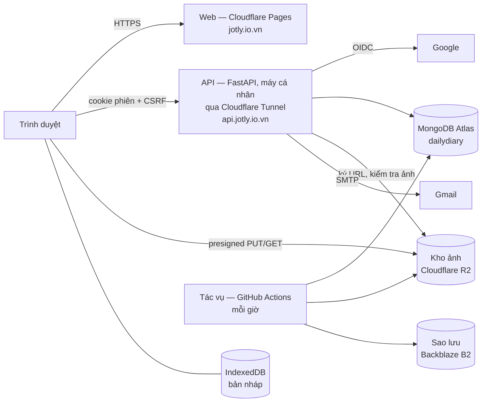

# Jotly – Đặc tả hệ thống

|                |                                                                                                                                                                                                               |
| -------------- | ------------------------------------------------------------------------------------------------------------------------------------------------------------------------------------------------------------- |
| **Phiên bản**  | 1.0 — mô tả hệ thống **hiện tại**                                                                                                                                                                             |
| **Cập nhật**   | 30/10/2026                                                                                                                                                                                                    |
| **Trạng thái** | Bản 1.0 hoàn thành (30/10/2026), chạy production tại `https://jotly.io.vn`; việc chưa làm: [`Backlog.md`](Backlog.md) |
| **Liên quan**  | Bối cảnh, lộ trình, kiếm tiền: [`Roadmap.md`](Roadmap.md) · Tiến độ: [`MVP_Plan.md`](MVP_Plan.md) · Cây dự án: [`Project_Structure.md`](Project_Structure.md) · Quyết định kiến trúc: [`adr/`](adr/README.md) · Hệ thiết kế: [`DESIGN.md`](../DESIGN.md) |

**Nguồn sự thật:** giới hạn số → [`shared/limits.json`](../shared/limits.json) (cấp `beta`); API →
`apps/web/src/api/openapi.json`; cấu hình → `apps/api/app/core/config.py`. Tài liệu này lệch với chúng thì chúng đúng.

## Mục lục

1. [Tóm tắt](#1-tóm-tắt) · 2. [Phạm vi](#2-phạm-vi) · 3. [Tính năng](#3-tính-năng) ·
4. [Yêu cầu phi tính năng](#4-yêu-cầu-phi-tính-năng) · 5. [Kiến trúc](#5-kiến-trúc) · 6. [Vận hành](#6-vận-hành) ·
7. [Việc còn mở](#7-việc-còn-mở)

---

## 1. Tóm tắt

**Jotly** (tên mã DailyDiary) — nhật ký cá nhân trên web, tiếng Việt: mỗi ngày một trang, chấm điểm tâm trạng 1–5 bằng
biểu tượng, thêm chữ, từ khóa, ảnh; nhìn lại qua dòng thời gian, lịch tháng, Year in Pixels; chia sẻ từng trang qua
link chỉ xem. Đăng nhập Google. Người dùng từ 16 tuổi.

|         |                                                                        |
| ------- | ---------------------------------------------------------------------- |
| Web     | `https://jotly.io.vn` — React SPA trên Cloudflare Pages                |
| API     | `https://api.jotly.io.vn` — FastAPI (Docker) trên máy cá nhân, ra Internet qua Cloudflare Tunnel |
| Dữ liệu | MongoDB Atlas (Singapore) · ảnh: Cloudflare R2 · sao lưu: Backblaze B2 |

---

## 2. Phạm vi

### 2.1. Đang có

- Nhật ký cá nhân, một người dùng; mỗi ngày tối đa một trang.
- Web responsive: máy tính và điện thoại từ 360 px, sáng/tối. Giao diện theo canvas "Jotly Design System"
  (*Mực & giấy · Sổ tay · Sổ dán*); khi thiết kế và kế hoạch khác nhau thì theo thiết kế.
- Đăng nhập Google; chia sẻ một trang qua link chỉ xem (ADR 0005).
- Thùng rác, xóa toàn bộ dữ liệu, xóa tài khoản, góp ý, chính sách quyền riêng tư.
- Vận hành: hạn mức dung lượng, rate limit, tác vụ dọn dẹp, sao lưu/khôi phục.

### 2.2. Không có

- Nhiều người dùng (nhật ký chung, bình luận, theo dõi) — chỉ chia sẻ một trang.
- Đăng nhập khác Google; ngôn ngữ khác tiếng Việt (ô English khóa "Sắp có").
- Theme, sticker, bộ biểu tượng mới; AI; thông báo đẩy; PWA; ứng dụng desktop/di động; thanh toán.
- **Xuất dữ liệu** (bỏ 21/10/2026; Hồ sơ ghi rõ "Jotly không có tính năng xuất dữ liệu").
- Bắt lỗi (Sentry) và phân tích sự kiện (Umami): **tạm gỡ**, xem 4.7.

---

## 3. Tính năng

### 3.0. Màn hình

| Đường dẫn                                                | Màn                                                                                     | Đăng nhập |
| -------------------------------------------------------- | --------------------------------------------------------------------------------------- | --------- |
| `/`                                                      | Trang chủ: giới thiệu (khách) · lời chào, chấm điểm nhanh, tóm tắt tháng (đã đăng nhập) | Không     |
| `/login`                                                 | Đăng nhập Google (+ "Đăng nhập thử" khi chạy dev)                                       | Không     |
| `/privacy`                                               | Chính sách quyền riêng tư                                                               | Không     |
| `/s/:token`                                              | Trang chia sẻ công khai                                                                 | Không     |
| `/onboarding`                                            | 3 bước lần đầu: tên → bộ biểu tượng → múi giờ                                           | Có        |
| `/today`                                                 | Viết trang hôm nay (tự lưu), dải 24 giờ, dải tháng                                      | Có        |
| `/day/:date` · `/day/:date/edit` · `/day/:date/backfill` | Xem một ngày · Sửa trang cũ · Ghi bù                                                    | Có        |
| `/timeline?m=YYYY-MM`                                    | Dòng thời gian + lịch + thống kê tháng                                                  | Có        |
| `/pixels`                                                | Year in Pixels                                                                          | Có        |
| `/search`                                                | Tìm kiếm                                                                                | Có        |
| `/profile` · `/profile/shares` · `/profile/trash`        | Hồ sơ & cài đặt · Trang đang chia sẻ · Thùng rác                                        | Có        |
| `*`                                                      | 404 (khung app hoặc khung công khai tùy trạng thái đăng nhập)                           | –         |

### F-01. Viết nhật ký

| Trường           | Bắt buộc | Thông số                                                                            |
| ---------------- | -------- | ----------------------------------------------------------------------------------- |
| Điểm (main icon) | **Có**   | 1–5; hình theo bộ biểu tượng trong hồ sơ (6 bộ, mặc định `sprout`)                  |
| Sub icon         | Không    | 0–1 emoji trong 47 gợi ý (`shared/icons.json`)                                      |
| Cờ hiệu          | Không    | 8 màu có sẵn (`shared/flag_colors.json`) hoặc màu tự thêm (tối đa 8); lưu `#RRGGBB` |
| Tiêu đề          | Không    | ≤ 100 ký tự                                                                         |
| Nội dung         | Không    | ≤ 20.000 ký tự, văn bản thuần, Unicode NFC                                          |
| Từ khóa          | Không    | ≤ 10, mỗi từ 1–30 ký tự, không trùng                                                |
| Ảnh              | Không    | ≤ 10/ngày                                                                           |

- **"Đã ghi"** = có điểm. **Ngày được ghi:** hôm nay và trước đó theo múi giờ hồ sơ; ngày tương lai → 422.
- **Nhãn:** sửa lần cuối trong chính ngày đó (múi giờ người dùng) → "ghi đúng ngày", ngược lại → "cập nhật muộn".
- **Ba cách viết:** Hôm nay (tự lưu) · Ghi bù (ngày đã qua chưa có trang) · Sửa trang cũ (chỉ lưu nháp, lên máy chủ khi
  bấm "Lưu thay đổi"). Chấm điểm nhanh ở trang chủ và dòng thời gian.
- **Xóa** là xóa mềm, không hỏi lại: vào Thùng rác ngay, thông báo có nút Hoàn tác trong 6 giây; khôi phục trong 30 ngày
  (`entry.restore_days`). Ghi lại vào ngày đã xóa mềm tạo
  trang mới thay bản cũ (ảnh cũ xóa ngay).
- **Ảnh:** chọn JPEG/PNG/HEIC/HEIF/WebP ≤ 10 MB; HEIC giải mã trên trình duyệt (WebAssembly). Trình duyệt nén: ảnh chính
  ≤ 1920 px, ≤ 1,5 MB; ảnh nhỏ ≤ 320 px, ≤ 200 KB; WebP 0,8 (JPEG khi không hỗ trợ WebP); **bỏ EXIF/GPS**; ảnh gốc không
  rời thiết bị. Kéo để sắp xếp; xóa ảnh là xóa trong kho.

### F-02. Dòng thời gian, lịch tháng, thống kê

- Theo tháng (tháng trên URL), mới nhất trước, 7 trang rồi "Xem thêm"; 1 request/tháng, mỗi trang 300 ký tự đầu + số ảnh.
- Lịch tháng: main icon, sub icon, màu cờ mỗi ngày; 1 request, không tải nội dung.
- Thống kê: ngày đã ghi / số ngày, điểm trung bình, phân bố 1–5, tổng ảnh, chuỗi ngày hiện tại và dài nhất (tính ở
  backend, vắt qua tháng), nhịp điểm (SVG/CSS).
- **Ghi bù** (trang tạo sau khi ngày đã qua) vẫn tô màu nhưng **không nối chuỗi**.
- Hôm nay chưa viết: lời mời + chấm điểm nhanh. Điện thoại: bấm ngày mở bảng xem nhanh.

### F-03. Year in Pixels

- 365/366 ô theo 12 tháng, tô theo điểm hoặc theo cờ (lựa chọn nhớ trên trình duyệt); ô trước ngày bắt đầu dùng là
  "trước khi dùng".
- 1 request/năm, vài KB (điểm là chuỗi 365/366 ký tự, `"0"` = chưa ghi). Chỉ chọn năm có dữ liệu. Bấm ô để xem nhanh.

### F-04. Đăng nhập và hồ sơ

- Google OIDC (`openid email profile`), chỉ nhận email đã xác minh; OAuth ở chế độ **In production**, thương hiệu đã xác minh (30/10/2026).
- Phiên 30 ngày, tự gia hạn; đăng xuất hủy phiên ngay.
- Hồ sơ: ảnh đại diện (mặc định link ảnh Google; cho tải ảnh riêng — cắt vuông 256 px, nén ≤ 2 MB — hoặc gỡ), tên
  1–50 ký tự, múi giờ IANA (đổi chỉ áp dụng cho ngày sau đó), bộ biểu tượng (áp cho **mọi ngày**), màu cờ riêng,
  giao diện sáng/tối/theo hệ thống/theo giờ (tối từ 20:00 đến 05:00 theo giờ của máy). Kèm: dung lượng ảnh, Thùng rác, Trang đang chia sẻ, Góp ý, xóa dữ liệu/tài khoản.

### F-05. Tìm kiếm

- Trong tiêu đề, nội dung, từ khóa; khớp chuỗi con, không phân biệt hoa thường. Gõ không dấu → so không dấu; gõ có dấu
  → so đúng dấu.
- Lọc: điểm (nhiều mức), khoảng thời gian (tháng này / 3 tháng / năm nay / mọi lúc — mặc định), có ảnh.
- Kết quả: tiêu đề + đoạn trích tô sáng; 6 từ khóa hay dùng. Tìm sau 300 ms ngừng gõ; 30 kết quả/lần, "Xem thêm" theo
  con trỏ. Từ khóa tìm kiếm không lên URL, không ghi log.

### F-06. Tự động lưu

- Nháp vào IndexedDB sau **1 s** ngừng gõ; lên máy chủ sau **4 s**, khi rời trang/chuyển tab; chỉ gửi khi khác bản đã lưu.
- Trạng thái: Đang lưu / Đã lưu / Chưa đồng bộ. Lỗi tạm thời: thử lại 2, 4, 8… s (tối đa 60 s), thử ngay khi có mạng.
- Xung đột: gửi kèm `updated_at` đã biết; máy chủ mới hơn (409) → hỏi giữ bản nào.
- Nháp gắn người dùng (băm email); xóa khi đã đồng bộ, đăng xuất, xóa dữ liệu/tài khoản.

### F-07. Thùng rác, xóa dữ liệu, xóa tài khoản

- **Thùng rác:** trang đã xóa trong 30 ngày, khôi phục từng trang; quá hạn → `purge_trash` xóa hẳn (ảnh → link → trang).
- **Xóa toàn bộ dữ liệu:** gõ `XÓA`; xóa mọi trang (cả thùng rác), ảnh nhật ký, link chia sẻ; giữ tài khoản, cài đặt,
  ảnh đại diện, góp ý.
- **Xóa tài khoản:** gõ đúng email; chỉ khi đăng nhập **trong 10 phút** (quá → 403 `REAUTH_REQUIRED`, có nút đăng nhập
  lại). Đăng xuất mọi thiết bị, xóa nhật ký, ảnh, ảnh đại diện, link, hồ sơ, phiên; kho dọn trong nền, dở dang thì
  `purge_accounts` làm nốt (đang dọn → đăng nhập báo "đang chờ xóa", 403 `ACCOUNT_DELETED`). Góp ý giữ nội dung, **ẩn
  danh**. Gửi email xác nhận (chỉ số lượng). Đăng nhập lại → tài khoản mới, trống.
- `deletion_log` chỉ ghi loại thao tác, thời điểm, số lượng — không `user_id`, email, nội dung.
- Bản sao lưu giữ 7 ngày: dữ liệu đã xóa có thể còn trong sao lưu tối đa 7 ngày, không dùng để khôi phục.

### F-09. Góp ý

Form từ Hồ sơ và menu tài khoản, ≤ 2.000 ký tự. Lưu `feedback` rồi gửi email về `FEEDBACK_TO_EMAIL` trong nền (kèm tên +
email người gửi, Reply-To = người gửi; form ghi rõ). Gửi thư lỗi không làm hỏng request (`emailed_at` = null).

### F-10. Chia sẻ một trang

- Mỗi ngày tối đa một link; người nhận chỉ xem, không cần đăng nhập. Chọn từng phần: tên, điểm, sub icon, cờ, tiêu đề,
  nội dung, từ khóa, từng ảnh; **ngày luôn hiện**, phải bật ít nhất một phần khác. Đổi lưu ngay.
- Tắt link = thu hồi vĩnh viễn; bật lại tạo token mới; link không có hạn dùng.
- Link tắt, trang xóa mềm, token sai, tài khoản đã xóa → cùng màn "Trang này không mở được" (404 chung).
- Trang công khai: rate limit theo IP, `noindex`, `no-store`, `no-referrer`; không lộ email/`user_id`/id nội bộ; ảnh qua
  link ký 1 giờ; token không ghi log.

---

## 4. Yêu cầu phi tính năng

### 4.1. Bảo mật và quyền riêng tư

| Yêu cầu    | Thông số                                                                                                                                                                                                                     |
| ---------- | ---------------------------------------------------------------------------------------------------------------------------------------------------------------------------------------------------------------------------- |
| Kết nối    | HTTPS bắt buộc; HSTS 1 năm (`includeSubDomains`) ở web (`_headers`) và API (middleware, chỉ production)                                                                                                                      |
| Header     | `X-Content-Type-Options: nosniff`, `X-Frame-Options: DENY`, `Referrer-Policy: strict-origin-when-cross-origin` (trang chia sẻ: `no-referrer`); web thêm `Permissions-Policy` và CSP (đang **Report-Only**)                   |
| Phân quyền | Mọi truy vấn lọc `user_id` từ phiên; bộ lọc/lệnh cập nhật dựng từ trường đã kiểm tra kiểu (chặn `$ne`, `$where`); tài nguyên không thuộc người dùng → 404; test truy cập chéo cho mọi endpoint                               |
| Phiên      | `dd_session` ngẫu nhiên (`HttpOnly`, `Secure`, `SameSite=Lax`), DB chỉ lưu SHA-256; CSRF: `Origin` + `X-CSRF-Token` khớp cookie `dd_csrf` (ADR 0002). Web và API cùng tên miền gốc (`io.vn` trong Public Suffix List), cookie `Domain=jotly.io.vn` (`COOKIE_DOMAIN`)        |
| Ảnh        | Kho riêng tư; khóa bắt đầu `user_id/`; link xem 1 giờ, link tải lên 5 phút                                                                                                                                                   |
| Log        | Mã người dùng nội bộ, phương thức, đường dẫn (bỏ query, che token chia sẻ), mã trạng thái, thời gian. **Không**: tiêu đề, nội dung, từ khóa, ảnh, IP, user agent, body. Giữ 14–30 ngày                                       |
| Quyền DB   | User API/tác vụ chỉ `readWrite@dailydiary` (không sửa validator); migration bằng user riêng `dbAdmin` + `readWrite`                                                                                                          |
| Bí mật     | Chỉ trong `apps/api/.env.prod` trên máy chạy API, GitHub Secrets, hoặc `.env` bị `.gitignore`; production từ chối khởi động khi thiếu `SESSION_SECRET` hoặc bật `DEV_LOGIN`; `/docs` tắt ở production                                       |
| Pháp lý    | `/privacy` liệt kê dữ liệu, cookie, log, nhà cung cấp, thời gian lưu, quyền người dùng — đúng với code. **Chưa rà soát pháp lý** (gồm chuyển dữ liệu ra nước ngoài: Singapore, Canada) — bắt buộc trước khi ra mắt công khai |

### 4.2. Toàn vẹn dữ liệu

| Yêu cầu       | Thông số                                                                                 |
| ------------- | ---------------------------------------------------------------------------------------- |
| Sao lưu DB    | 00:00, 08:00, 16:00 giờ VN sang kho khác nhà cung cấp; giữ 21 bản (7 ngày)               |
| Sao lưu ảnh   | Hằng ngày, chép tăng dần; bản sao của ảnh đã xóa giữ tối đa 7 ngày                       |
| Khôi phục     | `restore_db` vào DB khác; thử khôi phục hằng tháng                                       |
| Thời gian     | `entry_date` = ngày địa phương `YYYY-MM-DD`; mọi mốc khác UTC                            |
| Xóa mềm       | 30 ngày rồi xóa hẳn kèm ảnh                                                              |
| Ghi đồng thời | Mỗi ngày một document, ghi nguyên tử; xung đột bằng `updated_at`; ảnh dùng khóa lạc quan |

### 4.3. Hiệu năng

| Chỉ số              | Mục tiêu                | Hiện trạng (24/10/2026, Lighthouse mobile, local qua HTTP/2) |
| ------------------- | ----------------------- | ------------------------------------------------------------ |
| LCP                 | < 2,5 s                 | 2,3–3,1 s tùy màn — chưa đạt hết; đo lại trên production     |
| INP                 | < 200 ms                | TBT < 100 ms                                                 |
| CLS                 | < 0,1                   | ≤ 0,02                                                       |
| API đọc/ghi nhật ký | p95 < 500 ms            | Chưa đo trên production                                      |
| Tải 1 ảnh đã nén    | < 5 s, mạng bình thường | –                                                            |
| Thời gian hoạt động | ~99%                    | Phụ thuộc máy cá nhân chạy API (tắt, ngủ, mất mạng là ngừng) |

Đã áp dụng: tải lười mọi màn; gọi `/me` ngay khi mở app; loader tải trước dữ liệu của màn song song với chunk; font tự
host đã cắt (tiếng Việt + Latin), preload font tiêu đề và chữ thường; cache `/assets/*` 1 năm.

### 4.4. Rate limit

Trần chống lạm dụng (`shared/limits.json`). Vượt → 429 + `Retry-After`. Đếm trong bộ nhớ tiến trình (`memory://`): chỉ
đúng với một tiến trình; nhiều worker/instance → Redis.

| Nhóm            | Áp cho                                                           | Giới hạn         | Theo  |
| --------------- | ---------------------------------------------------------------- | ---------------- | ----- |
| `autosave`      | `PUT /entries/{date}`                                            | 20/phút          | người |
| `read`          | Đọc dữ liệu                                                      | 30/phút          | người |
| `me`            | `GET /me`                                                        | 120/phút         | người |
| `write`         | Sửa hồ sơ, xóa/khôi phục trang, xóa/sắp xếp ảnh, bật/tắt chia sẻ | 10/phút          | người |
| `photo_upload`  | Xin URL + xác nhận ảnh nhật ký                                   | 10/phút, 50/ngày | người |
| `avatar_upload` | Xin URL ảnh đại diện                                             | 5/phút, 20/ngày  | người |
| `search`        | Tìm kiếm                                                         | 60/phút          | người |
| `feedback`      | Gửi góp ý                                                        | 5/phút, 20/ngày  | người |
| `destructive`   | Xóa toàn bộ dữ liệu, xóa tài khoản                               | 3/phút, 10/ngày  | người |
| `login`         | Đăng nhập                                                        | 5/phút           | IP    |
| `logout`        | Đăng xuất                                                        | 20/phút          | IP    |
| `share_view`    | Trang chia sẻ công khai                                          | 60/phút          | IP    |

### 4.5. Dung lượng

- 500 MB/người (cấp `beta`); cảnh báo từ 80% ở Hồ sơ và ô tải ảnh; hết thì chặn tải ảnh (`STORAGE_QUOTA`).
- Tính ảnh chính + ảnh nhỏ của mọi trang, kể cả thùng rác; không tính ảnh đại diện.
- Gói hạ tầng hiện tại: Atlas M0 512 MB, R2 10 GB miễn phí, B2 10 GB miễn phí — theo dõi hằng tuần.

### 4.6. Tương thích

Chrome, Edge, Firefox, Safari bản mới trên máy tính; trình duyệt điện thoại từ 360 px. Font: Commissioner biến thiên
(cả chữ thường và tiêu đề; tiêu đề dùng trục FLAR), Young Serif (logo). Hệ thiết kế: [`DESIGN.md`](../DESIGN.md).

### 4.7. Theo dõi và đo lường — tạm gỡ

Sentry (bắt lỗi) và Umami (phân tích, không cookie) đã làm ở Bước 13 rồi gỡ khỏi code (24/10/2026); thêm lại từ commit
`dd35f04` và **cập nhật `/privacy` cùng lúc**. Quy tắc khi thêm lại:
- Sự kiện: `login`, `entry_created`, `entry_updated`, `photo_uploaded`, `calendar_viewed`, `pixels_viewed`, `search_used`;
  tắt hẳn khi chưa đặt DSN/script.
- Sentry: chỉ loại lỗi, stack (không biến cục bộ), URL bỏ query và che token, mã người dùng nội bộ; không body, query,
  cookie, header (trừ user-agent), breadcrumb click/gõ phím/console; backend bỏ thông điệp lỗi; React v11 phải tắt từng
  mục `dataCollection`.
- Umami: pageview đường dẫn đã làm sạch (`/s/:token`, ngày → `:date`); props chỉ boolean/giá trị liệt kê; `login` = lần
  đầu `/me` thành công trong tab; `entry_updated` ≤ 1 lần/30 phút/trang.
- CSP phải cho phép host của Sentry và Umami.

---

## 5. Kiến trúc

### 5.1. Sơ đồ



### 5.2. Công nghệ

| Phần                 | Công nghệ                                                                                                                                                                                                                                                                                                           |
| -------------------- | ------------------------------------------------------------------------------------------------------------------------------------------------------------------------------------------------------------------------------------------------------------------------------------------------------------------- |
| Web (`apps/web`)     | TypeScript 5.9, React 19, Vite 8, React Router 8 (data router, tải lười, loader tải trước), TanStack Query 5, `openapi-fetch` + kiểu sinh từ OpenAPI, Tailwind CSS 4 + shadcn/ui (Radix, CSS chép vào dự án — ADR 0003), Lucide, `date-fns(-tz)`, `browser-image-compression`, `heic-to`, `idb`; biểu đồ vẽ SVG/CSS |
| API (`apps/api`)     | Python 3.12 (uv), FastAPI 0.143, Uvicorn, Pydantic v2 + pydantic-settings, PyMongo async (ADR 0001), Authlib (Google OIDC), slowapi, boto3 (S3), `smtplib`                                                                                                                                                          |
| Kiểm thử, chất lượng | pytest + httpx trên MongoDB thật, Vitest + Testing Library, Playwright (máy tính + 360 px), ruff, oxlint, `tsc`                                                                                                                                                                                                     |
| Hạ tầng              | Docker trên máy cá nhân + Cloudflare Tunnel · Cloudflare Pages (Direct Upload), DNS, R2 · MongoDB Atlas M0 (Singapore, cluster `cluster0.auszmkf`) · Backblaze B2 · GitHub Actions (CI + cron) · Gmail SMTP                                                                                                                                    |
| Local                | Windows, uv, Docker Compose: MongoDB 8.0, MinIO (+ bucket ảnh và sao lưu), Mailpit                                                                                                                                                                                                                                  |

### 5.3. Cấu trúc repo

Monorepo: `apps/api`, `apps/web`, `shared/` (giới hạn + danh mục dùng chung), `docs/`, `.github/workflows/`. Cây đầy đủ và
khung ban đầu: [`Project_Structure.md`](Project_Structure.md) (nguồn duy nhất, ADR 0004).

- API: `routers/` (nhận request) → `services/` (nghiệp vụ + truy vấn, tham số đầu `user_id`) → MongoDB; `schemas/`
  (Pydantic), `core/` (cấu hình, bảo mật, log, rate limit, kho, email), `db/` (client, migration), `jobs/` (tác vụ).
- Web: `routes/` (màn, mỏng) ghép từ `features/` (mỗi tính năng một thư mục, không import lẫn nhau), dùng `components/`
  và `lib/`.

### 5.4. Mô hình dữ liệu (MongoDB, DB `dailydiary`)

- Một trang = một document; từ khóa và ảnh (≤ 10) nhúng bên trong → đọc/ghi một ngày là thao tác nguyên tử.
- `_id`/khóa tham chiếu là UUID (BSON subtype 4); thời gian BSON date UTC; `entry_date` là **chuỗi** `"YYYY-MM-DD"`.
- Không transaction nhiều document; xóa tài khoản viết theo thứ tự, chạy lại được.
- Validator `$jsonSchema` kiểm tra cấu trúc; giới hạn độ dài/số lượng kiểm tra ở backend theo `limits.json`.
- Migration `python -m app.db.migrate`: chỉ tiến, chạy lại an toàn, lịch sử trong `_migrations` — hiện **0001–0009**.

```
users
  _id uuid · google_sub string UNIQUE · email string (cập nhật mỗi lần đăng nhập)
  display_name string 1..50 · avatar_url string|null (link Google) · avatar_key string|null ("{user_id}/avatar/{id}.webp|jpg")
  timezone string (IANA) · icon_set_id string · onboarded_at date|null · custom_flag_colors ["#RRGGBB"] (≤ 8)
  account_tier "beta"|"free"|"premium" · joined_at date · deleted_at date|null (đang chờ xóa → chặn đăng nhập)

user_sessions                                  -- cookie dd_session
  _id binary (SHA-256 token; không lưu token, IP, user agent) · user_id uuid INDEX · created_at date
  expires_at date TTL (30 ngày, tự gia hạn)

entries                                        -- 1 document = 1 ngày
  _id uuid · user_id uuid · entry_date "YYYY-MM-DD" · score int 1..5 · sub_icon string|null · flag_color "#RRGGBB"|null
  title string|null (≤ 100) · content string|null (≤ 20.000) · title_norm, content_norm (chữ thường, không dấu)
  keywords [{keyword, norm}] (≤ 10)
  photos [{id uuid, storage_key, thumb_key, width, height, size_bytes, position 0..9, created_at}]
        -- key "{user_id}/YYYY/MM/DD/{id}[_thumb].webp|jpg"; đổi ảnh không đổi updated_at
  created_at, updated_at · deleted_at date|null (xóa mềm)
  UNIQUE (user_id, entry_date) · INDEX (user_id, entry_date), (user_id, keywords.norm, entry_date), (user_id, photos.id)
  INDEX (deleted_at) chỉ trang đã xóa mềm

share_links                                    -- tắt link = xóa document
  _id uuid · user_id · entry_date · token string UNIQUE (16 byte ngẫu nhiên, lưu gốc, không ghi log)
  show_name, show_score, show_sub_icon, show_flag, show_title, show_content, show_keywords bool · photo_ids [uuid]
  created_at, updated_at · UNIQUE (user_id, entry_date)

feedback       _id, user_id, message, created_at, emailed_at date|null, anonymized bool (tùy chọn)
deletion_log   _id, kind ("journal"|"account"|"trash"), at, pages, photos, share_links, feedback_anonymized — không có
               user_id/email/nội dung (validator chặn trường lạ) · INDEX (at)
user_items     _id, user_id, item_id, source, acquired_at · UNIQUE (user_id, item_id) — chưa dùng
```

### 5.5. API

Request ghi có cookie phiên phải kèm `Origin` hợp lệ + `X-CSRF-Token`. Lỗi: `{"error": {"code", "message"}}` — 401 chưa
đăng nhập · 403 `CSRF_FAILED` / `REAUTH_REQUIRED` / `ACCOUNT_DELETED` · 404 không có hoặc không thuộc người dùng · 409 xung
đột · 422 dữ liệu sai · 429 vượt giới hạn · 503 `STORAGE_UNAVAILABLE`. Danh sách đầy đủ kiểu dữ liệu: `openapi.json`.

| Nhóm      | Phương thức        | Đường dẫn                                      | Mô tả                                                                   |
| --------- | ------------------ | ---------------------------------------------- | ----------------------------------------------------------------------- |
| Hệ thống  | GET                | `/health`                                      | API + DB, không cần đăng nhập                                           |
| Đăng nhập | GET                | `/auth/google/login?tz=&next=`                 | Sang Google; `next` chỉ nhận `/profile`                                 |
|           | GET                | `/auth/google/callback`                        | Tạo/cập nhật người dùng, đặt cookie phiên                               |
|           | POST               | `/auth/logout`                                 | Hủy phiên                                                               |
|           | POST               | `/auth/dev-login`                              | Chỉ local/test khi `DEV_LOGIN`, không có trong OpenAPI                  |
| Hồ sơ     | GET / PATCH        | `/me`                                          | Lấy / sửa tên, ảnh đại diện, múi giờ, bộ biểu tượng, màu cờ, onboarding |
|           | POST               | `/me/avatar/upload-url`                        | Presigned URL ảnh đại diện                                              |
|           | GET                | `/me/data-summary`                             | Số trang/ảnh/link; dung lượng đã dùng, hạn mức, ngưỡng cảnh báo         |
|           | DELETE             | `/me`                                          | Xóa tài khoản `{confirm_email}`                                         |
| Nhật ký   | GET                | `/entries?month=YYYY-MM`                       | Các trang của tháng                                                     |
|           | GET / PUT / DELETE | `/entries/{date}`                              | Đọc / tạo-cập nhật (kèm `updated_at`) / xóa mềm                         |
|           | POST               | `/entries/{date}/restore`                      | Khôi phục                                                               |
|           | GET                | `/entries/trash`                               | Thùng rác                                                               |
|           | DELETE             | `/entries`                                     | Xóa toàn bộ dữ liệu `{confirm: "XÓA"}`                                  |
| Ảnh       | POST               | `/entries/{date}/photos/upload-url`            | 2 presigned PUT (ảnh chính + nhỏ)                                       |
|           | POST               | `/entries/{date}/photos`                       | Xác nhận ảnh                                                            |
|           | PATCH              | `/entries/{date}/photos/order`                 | Sắp xếp                                                                 |
|           | DELETE             | `/photos/{id}`                                 | Xóa ảnh                                                                 |
| Tổng hợp  | GET                | `/calendar/{year}/{month}`                     | Lịch + thống kê + chuỗi ngày                                            |
|           | GET                | `/pixels/{year}`                               | Year in Pixels dạng gọn                                                 |
| Tìm kiếm  | GET                | `/search?q=&score=&period=&has_photo=&cursor=` | Đoạn trích, `matched`, `total`, `next_cursor`                           |
|           | GET                | `/keywords/top` · `/sub-icons/top`             | Từ khóa / sub icon hay dùng                                             |
| Chia sẻ   | GET / PUT / DELETE | `/entries/{date}/share`                        | Xem / bật-chỉnh / tắt link                                              |
|           | GET                | `/shares`                                      | Trang đang chia sẻ                                                      |
|           | GET                | `/public/shares/{token}`                       | Trang công khai                                                         |
| Góp ý     | POST               | `/feedback`                                    | Lưu rồi gửi email trong nền                                             |

### 5.6. Luồng chính

**Mở app:** tải gói đầu → có cookie `dd_csrf` thì gọi `/me` ngay → router tải chunk của màn, loader tải trước dữ liệu
(trang hôm nay, lịch tháng…) khi `/me` về → 401 về trang chủ/đăng nhập; chưa onboarding → `/onboarding`.

**Đăng nhập:** `/auth/google/login?tz=<múi giờ trình duyệt>` → Google → `/auth/google/callback` (xác minh `id_token`, từ
chối email chưa xác minh) → tạo/cập nhật `users` (múi giờ lấy lần đầu) → tạo phiên, đặt `dd_session` + `dd_csrf` → về web.

**Tải ảnh:** trình duyệt kiểm tra, giải mã HEIC, nén ảnh chính + ảnh nhỏ (bỏ EXIF) → `upload-url` (kiểm số ảnh, hạn
mức, rate limit; URL 5 phút) → PUT thẳng lên R2 (có tiến độ) → xác nhận: backend dựng lại khóa từ `photo_id`, kiểm tồn
tại, magic bytes WebP/JPEG, dung lượng, thêm vào `photos` bằng khóa lạc quan; sai → xóa file, báo lỗi.

**Xác định ngày:** frontend tính `entry_date` theo múi giờ hồ sơ; backend từ chối ngày lớn hơn "hôm nay" theo múi giờ
đó; nhãn "ghi đúng ngày" so `updated_at` (đổi sang múi giờ người dùng) với `entry_date`.

### 5.7. Môi trường và triển khai

| Môi trường | Mô tả                                                                                                                                                                              |
| ---------- | ---------------------------------------------------------------------------------------------------------------------------------------------------------------------------------- |
| Local      | `docker compose up -d`; API `:8000`, web `:5173`, Mailpit `:8025`, MinIO `:9001`; đăng nhập thử bằng `DEV_LOGIN=true`                                                              |
| CI         | GitHub Actions `ci.yml`: ruff, pytest (MongoDB thật), kiểm tra lệch OpenAPI, oxlint, `tsc`, Vitest, build, e2e (MinIO + Mailpit)                                                   |
| Production | Web: Cloudflare Pages, tải lên bản build `apps/web/dist` (`VITE_API_URL`). API: `docker-compose.prod.yml`, image `apps/api/Dockerfile` (gốc repo, user thường, chỉ uvicorn), cổng `127.0.0.1:8000` sau tunnel. Tác vụ: `jobs.yml` |

- **Triển khai:** merge vào `main` qua PR (CI phải xanh) → build lại API trên máy chạy production
  (`docker compose -f docker-compose.prod.yml up -d --build`) và build web rồi tải `dist` lên Pages. Chưa tự động.
- **Migration:** chạy **tay** bằng user `jotly_migrate` *trước* khi merge code cần nó; container không chạy migration.
- **Cấu hình:** danh sách biến và giải thích — `apps/api/.env.example`, `apps/web/.env.example`; khóa production ở
  `apps/api/.env.prod` (máy chạy API) và GitHub Secrets. Các bước dựng từ đầu, việc định kỳ, sự cố: [`Deploy.md`](Deploy.md).

---

## 6. Vận hành

`uv run python -m app.jobs.run <tác vụ>` (trong `apps/api`); production chạy qua GitHub Actions `jobs.yml` (mỗi giờ, phút
17; chạy tay được; action ghim theo commit SHA, khóa chỉ cấp cho bước chạy). Mã thoát: `0` ổn hoặc chưa cấu hình · `1`
lỗi · `2` sai cú pháp.

| Tác vụ                                       | Lịch                   | Việc                                                                                                      |
| -------------------------------------------- | ---------------------- | --------------------------------------------------------------------------------------------------------- |
| `purge_accounts`                             | mỗi giờ                | Hoàn tất xóa tài khoản (kho, hồ sơ), gửi email xác nhận                                                   |
| `purge_trash`                                | 02:00 VN               | Xóa hẳn trang quá 30 ngày trong thùng rác (ảnh → link → trang); kho lỗi thì giữ trang; ghi `deletion_log` |
| `backup_db`                                  | 00:00, 08:00, 16:00 VN | Mọi collection → `.tar.gz` ở `db/YYYY/MM/DD/…`; giữ `BACKUP_KEEP` = 21                                    |
| `backup_photos`                              | 02:00 VN               | Chép tăng dần ảnh (cả ảnh đại diện) sang `photos/`; ảnh mất ở kho chính > 7 ngày thì xóa bản sao          |
| `restore_db --target <db> [--key] [--force]` | khi cần                | Chạy migration rồi nạp vào DB khác; từ chối DB đang chạy hoặc có dữ liệu nếu không `--force`              |

Kho sao lưu: Backblaze B2, bucket riêng tư, lifecycle "chỉ giữ phiên bản mới nhất". Repo công khai: GitHub tắt lịch sau
60 ngày không commit.

---

## 7. Việc còn mở

Toàn bộ việc chưa làm (vận hành, hạ tầng, bảo mật, pháp lý, sản phẩm) nằm ở [`Backlog.md`](Backlog.md).
