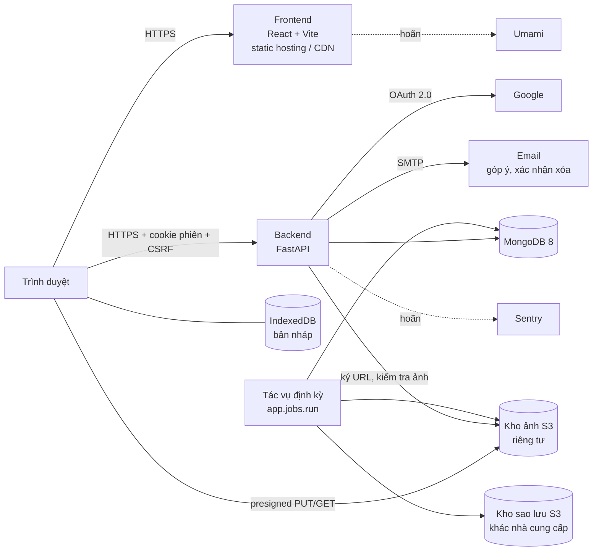

# Jotly (DailyDiary) – Tài liệu đặc tả

|                       |                                                                                  |
| --------------------- | -------------------------------------------------------------------------------- |
| **Phiên bản**         | 1.0 (viết lại theo code thực tế)                                                 |
| **Ngày cập nhật**     | 25/10/2026                                                                       |
| **Trạng thái MVP**    | Xong Bước 1–3, 5–13 (phần local), 11b; đang Bước 14 — xem [`MVP_Plan.md`](MVP_Plan.md) |
| **Phạm vi**           | Giai đoạn 1 – MVP (web app), kèm định hướng giai đoạn 2–3                        |
| **Quy mô thử nghiệm** | Dưới 20 người dùng                                                               |
| **Tài liệu liên quan** | Cây dự án: [`Project_Structure.md`](Project_Structure.md) · Quyết định kiến trúc: [`adr/`](adr/README.md) |

**Cách đọc:** mỗi con số giới hạn trong tài liệu này lấy từ [`shared/limits.json`](../shared/limits.json) (cấp `beta`);
khi hai nơi lệch nhau, `limits.json` là đúng. Quyết định đổi so với bản trước ghi ở [Phụ lục D](#phụ-lục-d-nhật-ký-quyết-định).

## Mục lục

1. [Tổng quan sản phẩm](#1-tổng-quan-sản-phẩm)
2. [Phạm vi MVP](#2-phạm-vi-mvp)
3. [Tính năng](#3-tính-năng)
4. [Yêu cầu phi tính năng](#4-yêu-cầu-phi-tính-năng)
5. [Kiến trúc hệ thống](#5-kiến-trúc-hệ-thống)
6. [Vận hành](#6-vận-hành)
7. [Lộ trình](#7-lộ-trình)
8. [Chiến lược kiếm tiền và giới hạn](#8-chiến-lược-kiếm-tiền-và-giới-hạn)
9. [Rủi ro](#9-rủi-ro)
10. [Câu hỏi mở](#10-câu-hỏi-mở)
- Phụ lục: [A. Sản phẩm tham khảo](#phụ-lục-a-sản-phẩm-tham-khảo) · [B. Kho ý tưởng](#phụ-lục-b-kho-ý-tưởng-cho-các-giai-đoạn-sau) ·
  [C. Tài liệu tham khảo](#phụ-lục-c-tài-liệu-và-công-cụ-tham-khảo) · [D. Nhật ký quyết định](#phụ-lục-d-nhật-ký-quyết-định)

---

## 1. Tổng quan sản phẩm

### 1.1. Vấn đề

Nhiều người có thói quen ghi lại cuộc sống: viết nhật ký, lưu ảnh, trang trí sổ. Ngày càng nhiều người cũng muốn thay
các nguồn "dopamine nhanh" (mạng xã hội, video ngắn) bằng nguồn lành mạnh hơn như tập luyện, học tập, rèn thói quen tốt.
Điểm chung là cảm giác tiến bộ khi nhìn lại hành trình của bản thân.

Sổ giấy khó mang theo, khó tìm lại, dễ thất lạc. Ứng dụng ghi chú thông thường lại khô khan và không cho người dùng thấy
sự thay đổi của mình theo thời gian.

### 1.2. Giải pháp

**Jotly** (tên mã dự án **DailyDiary**) là nhật ký cá nhân trên web: mỗi ngày một trang, chấm điểm tâm trạng trong một
chạm, thêm chữ, từ khóa, ảnh nếu muốn; rồi nhìn lại qua dòng thời gian, lịch tháng và Year in Pixels.
Khẩu hiệu: *"Chạm để ghi chú, mở để nhìn lại."*

### 1.3. Mục tiêu của MVP

MVP chứng minh một điều: **ghi lại mỗi ngày thật dễ, và nhìn lại thì thấy vui.**

- Web app chạy thật, người dùng thử vào được qua một đường link.
- Ghi được một ngày trong vài giây (chỉ cần chọn biểu tượng điểm).
- Nhìn lại hành trình qua dòng thời gian, lịch tháng và Year in Pixels.
- Thu thập góp ý (và khi bật lại phân tích sự kiện, số liệu sử dụng) để quyết định hướng phát triển.

### 1.4. Chỉ số thành công (tiêu chí chuyển sang giai đoạn 2)

| Chỉ số                                                          | Cách đo                                             |
| --------------------------------------------------------------- | --------------------------------------------------- |
| Tỉ lệ còn hoạt động sau 7 ngày (D7) và 30 ngày (D30)             | Collection `entries` (ngày có trang), phiên đăng nhập |
| Số ngày được ghi trung bình mỗi tuần / người                    | Collection `entries`                                |
| Tỉ lệ trang "ghi đúng ngày" so với "cập nhật muộn"              | So `updated_at` (theo múi giờ người dùng) với `entry_date` |
| Thiết bị thường dùng để ghi                                     | Phân tích sự kiện — **hoãn** cùng Umami (mục 4.7)   |
| Mức sẵn sàng giới thiệu cho người khác (NPS)                    | Khảo sát sau 2–4 tuần                               |

### 1.5. Đối tượng người dùng

- Người muốn viết nhật ký, lưu kỷ niệm trên thiết bị của mình; người đang viết sổ giấy muốn chuyển sang dạng số.
- Người yêu thích trang trí sổ (bullet journal, scrapbook).
- Người xây dựng lối sống lành mạnh và muốn thấy sự tiến bộ; người quan tâm sức khỏe tinh thần, theo dõi tâm trạng.
- Học sinh, sinh viên lưu hành trình học tập, ôn thi, du học; người thích du lịch lưu hành trình bằng chữ và ảnh.
- Cha mẹ ghi lại quá trình lớn lên của con; người đang trải qua thay đổi lớn trong cuộc sống.
- Cặp đôi, nhóm bạn, gia đình lưu kỷ niệm chung *(giai đoạn sau)*.

Độ tuổi: **từ 16 tuổi** (chính sách quyền riêng tư, 24/10/2026).

---

## 2. Phạm vi MVP

### 2.1. Trong phạm vi

- Trải nghiệm **cá nhân**: một người dùng, nhật ký riêng.
- **Web app**, ưu tiên trình duyệt máy tính; giao diện riêng cho điện thoại từ 360 px. Luồng "ghi nhanh" (chọn điểm,
  thêm ảnh) phải mượt trên điện thoại.
- Đăng nhập bằng tài khoản Google.
- Chia sẻ **một trang** qua link chỉ xem, người viết chọn phần được hiện (F-10, ADR 0005).
- Giao diện tiếng Việt, chế độ sáng/tối. Thiết kế theo canvas "Jotly Design System" (màu *Mực & giấy*, chữ *Sổ tay*,
  nền tảng *Sổ dán*); khi thiết kế và kế hoạch khác nhau thì theo thiết kế.

### 2.2. Ngoài phạm vi MVP

- Nhiều người dùng: nhật ký chung, bình luận, theo dõi người khác (chỉ có chia sẻ một trang, F-10).
- Đăng nhập Facebook và nhà cung cấp khác.
- Theme, trang trí, sticker; thêm bộ biểu tượng mới (làm sau khi sản phẩm hoàn thiện).
- AI, video tổng kết, thông báo đẩy, PWA.
- Ứng dụng desktop, ứng dụng di động.
- Thanh toán, tiền ảo.
- **Xuất dữ liệu** (bỏ 21/10/2026; Hồ sơ ghi rõ "Jotly không có tính năng xuất dữ liệu").
- Ngôn ngữ khác tiếng Việt (ô English hiện khóa "Sắp có").

---

## 3. Tính năng

Mức ưu tiên: **P0** bắt buộc · **P1** nên có · **P2** giai đoạn sau.

| Mã   | Tính năng                                   | Ưu tiên | Trạng thái              |
| ---- | ------------------------------------------- | ------- | ----------------------- |
| F-01 | Viết nhật ký trong ngày (chữ, biểu tượng, ảnh) | P0   | Xong (Bước 5, 7)        |
| F-02 | Dòng thời gian, lịch tháng, thống kê tháng  | P0      | Xong (Bước 8, 9)        |
| F-03 | Year in Pixels                              | P0      | Xong (Bước 10)          |
| F-04 | Đăng nhập Google, hồ sơ người dùng          | P0      | Xong (Bước 3)           |
| F-05 | Tìm kiếm                                    | P0      | Xong (Bước 11)          |
| F-06 | Tự động lưu, trạng thái đồng bộ             | P0      | Xong (Bước 6)           |
| F-07 | Thùng rác, xóa toàn bộ dữ liệu, xóa tài khoản | P1    | Xong (Bước 12)          |
| F-08 | ~~Xuất dữ liệu (JSON)~~                     | –       | Bỏ (21/10/2026)         |
| F-09 | Góp ý trong app                             | P1      | Xong (Bước 12)          |
| F-10 | Chia sẻ một trang qua link chỉ xem          | P1      | Xong (Bước 11b)         |

### F-01. Viết nhật ký trong ngày

Mỗi người dùng có tối đa **1 trang cho mỗi ngày**.

| Trường                       | Bắt buộc | Thông số                                                                      |
| ---------------------------- | -------- | ----------------------------------------------------------------------------- |
| Biểu tượng chính (điểm)      | **Có**   | Số nguyên 1–5; hình vẽ theo bộ biểu tượng trong hồ sơ (6 bộ, mặc định `sprout`) |
| Biểu tượng phụ (sub icon)    | Không    | 0–1 emoji trong danh sách 47 gợi ý (`shared/icons.json`)                      |
| Cờ hiệu                      | Không    | 1 màu: 8 màu có sẵn (`shared/flag_colors.json`) hoặc màu tự thêm (tối đa 8); lưu `#RRGGBB` |
| Tiêu đề                      | Không    | 0–100 ký tự                                                                   |
| Nội dung                     | Không    | 0–20.000 ký tự, văn bản thuần, chuẩn hóa Unicode NFC                          |
| Từ khóa                      | Không    | 0–10 từ khóa, mỗi từ 1–30 ký tự, không trùng                                  |
| Ảnh                          | Không    | 0–10 ảnh/ngày                                                                 |

Quy tắc:
- **"Đã ghi"** = đã chọn biểu tượng chính; mọi trường khác tùy chọn (giữ chân người dùng cả khi họ chỉ muốn chấm điểm).
- **Ngày được ghi**: hôm nay và các ngày trước, theo múi giờ trong hồ sơ; backend từ chối ngày tương lai (422).
- **Nhãn thời điểm**: lần sửa cuối rơi vào chính ngày đó (theo múi giờ người dùng) → **"ghi đúng ngày"**; ngược lại →
  **"cập nhật muộn"**.
- **Ba cách viết**: *Hôm nay* (tự lưu), *Ghi bù* một ngày đã qua chưa có trang, *Sửa trang cũ* (chỉ lưu nháp, lên máy chủ
  khi bấm "Lưu thay đổi"). Trang chủ và dòng thời gian có **chấm điểm nhanh** cho hôm nay.
- **Xóa** cần xác nhận và là **xóa mềm**: trang vào Thùng rác, khôi phục được trong 30 ngày (`entry.restore_days`).
  Ghi lại vào một ngày đã xóa mềm tạo trang mới thay cho bản đã xóa (ảnh cũ bị xóa ngay).
- **Hiển thị**: sub icon nhỏ cạnh main icon, tỉ lệ khoảng 0,5–0,6 (biến giao diện).

Ảnh:
- Người dùng chọn JPEG, PNG, HEIC/HEIF hoặc WebP, tối đa **10 MB/ảnh gốc**. HEIC được giải mã ngay trên trình duyệt
  (WebAssembly, không gọi CDN).
- Trình duyệt nén trước khi tải lên: ảnh chính cạnh dài ≤ 1920 px, ≤ 1,5 MB; ảnh thu nhỏ ≤ 320 px, ≤ 200 KB; WebP chất
  lượng 0,8 (JPEG khi trình duyệt không hỗ trợ WebP). Khi nén, **EXIF (kể cả GPS) bị bỏ**.
- **Ảnh gốc không rời khỏi thiết bị**; giao diện báo điều này.
- Kéo để sắp xếp; xóa một ảnh là xóa luôn trong kho. Ảnh tính vào hạn mức dung lượng (mục 4.5).

### F-02. Dòng thời gian, lịch tháng, thống kê tháng

- **Dòng thời gian theo tháng**: mới nhất ở trên, hiện 7 trang rồi "Xem thêm"; cả tháng lấy trong **1 request**, mỗi
  trang chỉ gồm 300 ký tự đầu nội dung và số ảnh. Tháng nằm trên URL (`/timeline?m=2026-09`).
- **Lịch tháng**: mỗi ngày hiện main icon, sub icon, màu cờ; cả tháng 1 request, không tải nội dung.
- **Thống kê tháng**: số ngày đã ghi / số ngày; điểm trung bình; phân bố điểm 1–5; tổng số ảnh; chuỗi ngày liên tiếp
  (hiện tại và dài nhất, tính ở backend, vắt qua tháng); nhịp điểm theo ngày (biểu đồ vẽ bằng SVG/CSS).
- **Ghi bù**: trang tạo sau khi ngày đó đã qua vẫn tô màu trong lịch và Year in Pixels, nhưng **không nối lại chuỗi**.
- **Hôm nay chưa viết**: dòng thời gian hiện lời mời và chấm điểm nhanh (thiết kế B8-Timeline-Today).
- Điện thoại: bấm một ngày mở bảng xem nhanh.
- Mục tiêu: lịch + thống kê tải dưới 1 giây.

### F-03. Year in Pixels

- Lưới 365/366 ô theo 12 tháng, tô theo điểm; ngày chưa ghi màu trung tính; ô trước ngày bắt đầu dùng Jotly là "trước khi dùng".
- Cả năm **1 request**, vài KB: điểm là chuỗi 365/366 ký tự (`"0"` = chưa ghi), cờ và ngày ghi bù chỉ liệt kê ngày có.
- Rê chuột/bấm để xem nhanh, mở trang của ngày đó.
- Chọn năm: chỉ các năm có dữ liệu.
- **Tô theo: Điểm | Cờ hiệu**, lựa chọn nhớ trên trình duyệt.

### F-04. Đăng nhập và hồ sơ

- Đăng nhập bằng Google (OAuth 2.0, scope `openid email profile`); chỉ nhận email đã xác minh. Thời kỳ thử nghiệm để
  OAuth ở chế độ **Testing** với danh sách email người dùng thử.
- Lần đầu: 3 bước giới thiệu (`/onboarding`) — tên, bộ biểu tượng, múi giờ.
- Phiên đăng nhập 30 ngày, tự gia hạn khi dùng; đăng xuất hủy phiên ngay.
- Hồ sơ:

| Trường         | Thông số                                                                                                  |
| -------------- | --------------------------------------------------------------------------------------------------------- |
| Ảnh đại diện   | Mặc định ảnh Google (chỉ lưu link). Cho tải ảnh riêng (cắt vuông 256 px, nén trên trình duyệt, ≤ 2 MB) hoặc gỡ ảnh |
| Tên            | 1–50 ký tự, mặc định từ Google                                                                            |
| Múi giờ        | IANA (vd `Asia/Ho_Chi_Minh`), tự nhận từ trình duyệt lần đầu, sửa được; đổi chỉ áp dụng cho các ngày sau đó |
| Bộ biểu tượng  | 1 trong 6 bộ; áp cho **mọi ngày**, kể cả ngày đã ghi (đổi hình, giữ điểm)                                  |
| Màu cờ riêng   | Tối đa 8 màu tự thêm từ bảng pha màu                                                                      |
| Giao diện      | Sáng / Tối / Theo hệ thống, lưu trên trình duyệt                                                          |

- Hồ sơ còn có: dung lượng ảnh đã dùng, Thùng rác, Trang đang chia sẻ, Góp ý, xóa dữ liệu/tài khoản, link chính sách.

### F-05. Tìm kiếm

- Phạm vi: tiêu đề, nội dung, từ khóa.
- Khớp **chuỗi con**, không phân biệt hoa thường. Gõ **không dấu** thì so không dấu (`da lat` khớp `Đà Lạt`); gõ
  **có dấu** thì so đúng dấu (`mưa` không khớp `mua`).
- Bộ lọc kết hợp: điểm (nhiều mức), khoảng thời gian (tháng này / 3 tháng / năm nay / mọi lúc — mặc định mọi lúc), chỉ
  ngày có ảnh. Khoảng thời gian theo múi giờ người dùng.
- Kết quả: tiêu đề + đoạn trích quanh chỗ khớp, tô sáng; "Từ khóa hay dùng" (6 từ khóa của chính người dùng).
- Tìm sau 300 ms ngừng gõ; 30 kết quả/lần, mới nhất trước, "Xem thêm" theo con trỏ; phản hồi dưới 500 ms.
- **Từ khóa tìm kiếm là nội dung nhật ký**: không lên URL của trang, không ghi log.

### F-06. Tự động lưu

- Ghi nháp vào IndexedDB sau **1 giây** ngừng gõ; đồng bộ lên máy chủ sau **4 giây**, khi rời trang hoặc chuyển tab;
  chỉ gửi khi nội dung khác bản đã đồng bộ.
- Trạng thái: **Đang lưu / Đã lưu / Chưa đồng bộ** (mất mạng).
- Lỗi tạm thời (mất mạng, 5xx, 429): thử lại sau 2, 4, 8… giây (tối đa 60 giây), thử ngay khi có mạng lại; cảnh báo
  khi đóng tab còn dữ liệu chưa đồng bộ.
- **Xung đột**: mỗi lần lưu gửi kèm `updated_at` đã biết; máy chủ có bản mới hơn (409) thì hỏi người dùng giữ bản nào.
- Nháp gắn với người dùng (mã băm của email, không lưu email); xóa khi đã đồng bộ, khi đăng xuất, xóa dữ liệu hoặc xóa tài khoản.

### F-07. Thùng rác, xóa toàn bộ dữ liệu, xóa tài khoản

- **Thùng rác** (Hồ sơ › Thùng rác): trang đã xóa còn trong 30 ngày, mới xóa nhất trước, khôi phục từng trang. Quá hạn
  thì tác vụ `purge_trash` xóa hẳn (ảnh → link chia sẻ → trang).
- **Xóa toàn bộ dữ liệu**: xóa mọi trang (cả trong thùng rác), ảnh nhật ký, link chia sẻ; **giữ** tài khoản, hồ sơ, cài
  đặt, ảnh đại diện, góp ý. Xác nhận bằng gõ `XÓA` (backend kiểm tra lại). Hộp thoại cho biết số trang, ảnh, link sẽ mất.
- **Xóa tài khoản**:
  - Xác nhận bằng gõ đúng email; chỉ được làm khi đăng nhập **trong 10 phút gần nhất** (quá thì 403 `REAUTH_REQUIRED`,
    giao diện có nút "Đăng nhập lại").
  - Đăng xuất mọi thiết bị ngay; xóa nhật ký, ảnh, ảnh đại diện, link chia sẻ, hồ sơ, phiên. Kho ảnh dọn trong nền;
    dở dang thì tác vụ `purge_accounts` làm nốt. Trong lúc đang dọn, đăng nhập lại báo "đang chờ xóa".
  - Góp ý **giữ nội dung nhưng ẩn danh** (`user_id` thay bằng mã ngẫu nhiên).
  - Xong gửi **email xác nhận** tới chính chủ (chỉ số lượng, không có nội dung; tài khoản đăng nhập thử không gửi).
  - Đăng nhập lại bằng cùng Google tạo **tài khoản mới, trống**. Tài khoản Google không bị ảnh hưởng.
- **Ghi nhận việc xóa**: `deletion_log` chỉ lưu loại thao tác, thời điểm, số lượng — không `user_id`, email hay nội dung.
- **Sao lưu**: bản sao lưu giữ 7 ngày, nên dữ liệu đã xóa có thể còn trong sao lưu tối đa 7 ngày; không dùng sao lưu để
  khôi phục dữ liệu đã xóa. Hộp thoại xóa, email xác nhận và chính sách quyền riêng tư đều nói rõ.

### F-09. Góp ý

- Form ngắn mở từ Hồ sơ và menu tài khoản; tối đa 2.000 ký tự.
- Lưu vào `feedback` rồi gửi email về hộp thư của chủ sản phẩm (`FEEDBACK_TO_EMAIL`) trong nền; thư kèm tên + email
  người gửi và đặt Reply-To là người gửi (form ghi rõ). Gửi thư lỗi không làm hỏng request (góp ý vẫn trong DB,
  `emailed_at` = null). Không ghi nội dung vào log.

### F-10. Chia sẻ một trang (ADR 0005)

- Từ trang một ngày, bật **link chia sẻ** (mỗi ngày tối đa một link). Người nhận chỉ xem, không cần đăng nhập.
- Người viết chọn từng phần: tên, điểm & icon chính, sub icon, màu cờ, tiêu đề, nội dung, từ khóa, từng ảnh. **Ngày viết
  luôn hiện**; phải bật ít nhất một phần khác mới sao chép được link. Thay đổi lưu ngay.
- **Tắt link** là thu hồi vĩnh viễn; bật lại tạo link mới. Link không có hạn dùng. "Trang đang chia sẻ" (Hồ sơ) liệt kê,
  sao chép, chỉnh, tắt link.
- Link tắt, trang bị xóa mềm, token sai hoặc tài khoản đã xóa: cùng một màn "Trang này không mở được".
- Trang công khai: rate limit theo IP, `noindex`, không cache, không gửi Referer; không lộ email, `user_id`, id nội bộ;
  ảnh qua link ký 1 giờ. Token không ghi vào log.

---

## 4. Yêu cầu phi tính năng

### 4.1. Bảo mật và quyền riêng tư

| Yêu cầu             | Thông số                                                                                                   |
| ------------------- | ---------------------------------------------------------------------------------------------------------- |
| Kết nối             | HTTPS bắt buộc, TLS 1.2+, bật HSTS                                                                          |
| Phân quyền          | Mỗi người chỉ đọc/ghi dữ liệu của mình. Mọi truy vấn lọc theo `user_id` từ phiên, không từ tham số. Bộ lọc và lệnh cập nhật dựng từ trường đã kiểm tra kiểu (chặn `$ne`, `$where`…). Có test truy cập chéo cho mọi endpoint; tài nguyên không thuộc người dùng trả 404 |
| Ảnh                 | Kho riêng tư; khóa ảnh bắt đầu bằng `user_id/`; link xem có hạn 1 giờ, link tải lên 5 phút                   |
| Phiên đăng nhập     | Token ngẫu nhiên trong cookie `dd_session` (`HttpOnly`, `Secure`, `SameSite=Lax`); DB chỉ lưu SHA-256 của token. Chống CSRF: kiểm tra `Origin` + header `X-CSRF-Token` khớp cookie `dd_csrf` (ADR 0002) |
| Log                 | Chỉ mã người dùng nội bộ, phương thức, đường dẫn (bỏ query, che token chia sẻ), mã trạng thái, thời gian. **Không** ghi tiêu đề, nội dung, từ khóa, ảnh, IP, user agent, body. Giữ 14–30 ngày |
| Công cụ bắt lỗi     | Hoãn (mục 4.7); khi thêm lại phải lọc bỏ nội dung nhật ký                                                   |
| Pháp lý             | Trang chính sách quyền riêng tư công khai `/privacy`, đúng với code. **Trước khi ra mắt công khai:** rà soát quy định bảo vệ dữ liệu cá nhân của Việt Nam, gồm chuyển dữ liệu ra nước ngoài (sao lưu ở Canada, hosting dự kiến Singapore) |
| Bí mật              | Chỉ trong biến môi trường / `.env` (bị `.gitignore`); production từ chối khởi động khi thiếu `SESSION_SECRET` hoặc bật `DEV_LOGIN` |
| Quản trị máy chủ    | Nếu dùng SSH: chỉ SSH key, tắt đăng nhập root, không đưa private key lên repo                                |

### 4.2. Toàn vẹn dữ liệu

| Yêu cầu                   | Thông số                                                                                 |
| ------------------------- | ---------------------------------------------------------------------------------------- |
| Sao lưu cơ sở dữ liệu     | 3 lần/ngày: 00:00, 08:00, 16:00 giờ Việt Nam, sang kho sao lưu khác nhà cung cấp            |
| Giữ bản sao lưu           | 7 ngày (21 bản); dữ liệu đã xóa còn trong sao lưu tối đa 7 ngày, không dùng để khôi phục   |
| Sao lưu ảnh               | Hằng ngày, chép tăng dần; bản sao của ảnh đã xóa giữ tối đa 7 ngày                         |
| Kiểm tra khôi phục        | Thử khôi phục ít nhất 1 lần trước khi mời người dùng (đã thử trên local 24/10/2026)       |
| Múi giờ                   | `entry_date` là ngày địa phương (`YYYY-MM-DD`); mọi mốc thời gian khác lưu UTC              |
| Xóa mềm                   | Trang xóa giữ 30 ngày rồi mới xóa hẳn (kèm ảnh)                                          |
| Ghi đồng thời             | Mỗi ngày một document, ghi nguyên tử; xung đột phát hiện bằng `updated_at`; ảnh dùng khóa lạc quan |

### 4.3. Hiệu năng

| Chỉ số                   | Mục tiêu                         | Hiện trạng (24/10/2026, đo local)                         |
| ------------------------ | -------------------------------- | --------------------------------------------------------- |
| API đọc/ghi nhật ký      | p95 dưới 500 ms                  | Chưa đo trên production                                    |
| Tải trang (LCP)          | Dưới 2,5 giây                    | Lighthouse mobile: 2,3–3,1 s tùy màn (chưa đạt hết)       |
| Phản hồi tương tác (INP) | Dưới 200 ms                      | TBT < 100 ms                                              |
| Độ ổn định bố cục (CLS)  | Dưới 0,1                         | ≤ 0,02                                                    |
| Tải lên 1 ảnh đã nén     | Dưới 5 giây với mạng bình thường | –                                                         |
| Thời gian hoạt động      | Khoảng 99%                       | Chưa triển khai                                           |

Biện pháp đã áp dụng: tải lười mọi màn (kể cả trang chủ, đăng nhập); gọi `/me` ngay khi mở app; loader tải trước dữ
liệu của màn song song với chunk; font tự host đã cắt còn ký tự tiếng Việt + Latin, preload font tiêu đề và chữ thường.

### 4.4. Giới hạn tần suất (rate limit)

Mức trần chống lạm dụng, không phải mức dùng dự kiến; điều chỉnh sau tuần thử nghiệm đầu. Giá trị trong
`shared/limits.json` (`rate_limits`, `ip_rate_limits`).

| Nhóm             | Áp cho                                         | Giới hạn                   | Theo     |
| ---------------- | ---------------------------------------------- | -------------------------- | -------- |
| `autosave`       | Lưu trang (`PUT /entries/{date}`)              | 20/phút                    | người    |
| `read`           | Đọc dữ liệu                                    | 30/phút                    | người    |
| `me`             | `GET /me`                                      | 120/phút                   | người    |
| `write`          | Sửa hồ sơ, xóa/khôi phục trang, ảnh (xóa, sắp xếp), bật/tắt chia sẻ | 10/phút | người    |
| `photo_upload`   | Xin URL tải ảnh nhật ký                        | 10/phút, 50/ngày           | người    |
| `avatar_upload`  | Xin URL tải ảnh đại diện                       | 5/phút, 20/ngày            | người    |
| `search`         | Tìm kiếm                                       | 60/phút                    | người    |
| `feedback`       | Gửi góp ý                                      | 5/phút, 20/ngày            | người    |
| `destructive`    | Xóa toàn bộ dữ liệu, xóa tài khoản             | 3/phút, 10/ngày            | người    |
| `login`          | Đăng nhập                                      | 5/phút                     | IP       |
| `logout`         | Đăng xuất                                      | 20/phút                    | IP       |
| `share_view`     | Mở trang chia sẻ công khai                     | 60/phút                    | IP       |

Bộ đếm hiện ở bộ nhớ tiến trình (`RATE_LIMIT_STORAGE_URI=memory://`): chỉ đúng khi chạy một tiến trình; nhiều worker
hoặc nhiều instance thì chuyển sang Redis. Vượt giới hạn trả 429 kèm `Retry-After`.

### 4.5. Dung lượng

| Hạng mục                     | Thông số                                                                                        |
| ---------------------------- | ----------------------------------------------------------------------------------------------- |
| Hạn mức mỗi người            | 500 MB (cấp `beta`); cảnh báo từ 80% ở Hồ sơ và ô tải ảnh; hết hạn mức thì chặn tải ảnh (`STORAGE_QUOTA`) |
| Cách tính                    | Ảnh chính + ảnh thu nhỏ của mọi trang, kể cả trong thùng rác; không tính ảnh đại diện            |
| Ước tính xấu nhất            | 10 ảnh × 0,5 MB × 365 ngày ≈ 1,8 GB/người/năm                                                    |

Theo dõi tổng dung lượng hằng tuần, đối chiếu với giới hạn gói dịch vụ. Ảnh tải lên nhưng không xác nhận hiện còn nằm
lại trong kho và không tính hạn mức — cần tác vụ dọn (mục 10).

### 4.6. Tương thích

- Bản mới của Chrome, Edge, Firefox, Safari trên máy tính; trình duyệt điện thoại từ màn hình 360 px.
- Phông chữ hỗ trợ tốt tiếng Việt: Be Vietnam Pro (chữ thường), Lora (tiêu đề), Young Serif (logo).

### 4.7. Theo dõi và đo lường — **hoãn**

> Sentry (bắt lỗi) và Umami (phân tích sự kiện, không cookie) đã làm ở Bước 13 rồi **tạm gỡ khỏi code** (24/10/2026).
> Thêm lại từ commit `dd35f04`, theo đúng các quy tắc dưới, và cập nhật trang `/privacy` cùng lúc.

- Sự kiện dự kiến: `login`, `entry_created`, `entry_updated`, `photo_uploaded`, `calendar_viewed`, `pixels_viewed`,
  `search_used`. Tắt hẳn khi chưa đặt DSN/địa chỉ script.
- Sentry chỉ gửi loại lỗi, stack (không biến cục bộ), URL đã bỏ query và che token chia sẻ, mã người dùng nội bộ. Không
  gửi body, query, cookie, header (trừ user-agent), breadcrumb click/gõ phím/console. Backend bỏ cả thông điệp lỗi; web
  giữ thông điệp đã làm sạch (bỏ query, đoạn trong ngoặc kép, cắt 200 ký tự). Sentry React v11 dùng `dataCollection`
  thay `sendDefaultPii`: phải tắt từng mục.
- Umami: pageview với đường dẫn đã làm sạch (`/s/:token`, ngày → `:date`, không query); props chỉ là boolean hoặc giá
  trị liệt kê. `login` = lần đầu `/me` thành công trong phiên của tab; `entry_updated` tối đa 1 lần/30 phút/trang.
- Có CSP thì phải cho phép host của Sentry và Umami.

---

## 5. Kiến trúc hệ thống

### 5.1. Sơ đồ tổng thể



### 5.2. Công nghệ

**Frontend** (`apps/web`)

| Thành phần            | Công nghệ                                                                   |
| --------------------- | --------------------------------------------------------------------------- |
| Ngôn ngữ, build       | TypeScript 5.9, React 19, Vite 8 (Rolldown)                                 |
| Định tuyến            | React Router 8 (data router, tải lười mọi màn, loader tải trước dữ liệu)    |
| Gọi API, bộ nhớ đệm   | TanStack Query 5; `openapi-fetch` với kiểu sinh từ OpenAPI (`openapi-typescript`) |
| Giao diện             | Tailwind CSS 4, shadcn/ui (Radix, CSS chép vào dự án — ADR 0003), Lucide    |
| Ngày, múi giờ         | `date-fns` + `date-fns-tz`                                                  |
| Ảnh                   | `browser-image-compression`, `heic-to` (giải mã HEIC bằng WebAssembly)      |
| Lưu nháp              | IndexedDB qua `idb`                                                         |
| Biểu đồ               | Vẽ bằng SVG/CSS, không dùng thư viện                                        |
| Kiểm tra form         | Theo `shared/limits.json`; kiểu dữ liệu từ OpenAPI                          |
| Font                  | Tự host (`scripts/subset_fonts.py`), Lora qua `@fontsource/lora`            |
| Kiểm thử, lint        | Vitest + Testing Library, Playwright, oxlint, `tsc`                         |

**Backend** (`apps/api`)

| Thành phần                | Công nghệ                                                                   |
| ------------------------- | --------------------------------------------------------------------------- |
| Ngôn ngữ, framework       | Python 3.12 (uv), FastAPI 0.143, Uvicorn, Pydantic v2 + pydantic-settings    |
| Cơ sở dữ liệu             | PyMongo async (`AsyncMongoClient`), migration tự viết `python -m app.db.migrate` (ADR 0001) |
| Đăng nhập                 | Authlib (Google OIDC), phiên lưu DB (ADR 0002)                               |
| Rate limit                | slowapi                                                                     |
| Kho ảnh, sao lưu          | boto3 (giao thức S3)                                                        |
| Kiểm tra ảnh phía server  | Tồn tại, định dạng (magic bytes WebP/JPEG), dung lượng; không xử lý ảnh (không Pillow) |
| Email                     | `smtplib` (Gmail SMTP khi chạy thật, Mailpit ở local)                        |
| Kiểm thử, lint            | pytest + httpx (MongoDB thật), ruff                                         |

**Hạ tầng**

| Thành phần            | Lựa chọn                                                                     |
| --------------------- | ---------------------------------------------------------------------------- |
| Cơ sở dữ liệu         | **MongoDB Atlas** (Singapore; gói free M0 cho beta, không có sao lưu tự động → dùng `backup_db`) |
| Kho ảnh               | **Cloudflare R2** (bucket `jotly-photos`, riêng tư, CORS cho `https://jotly.io.vn`) |
| Kho sao lưu           | **Backblaze B2** (đã chốt 24/10/2026, khác nhà cung cấp kho ảnh)              |
| Hosting frontend      | **Cloudflare Pages** — `https://jotly.io.vn` (header trong `apps/web/public/_headers`) |
| Hosting backend       | **Render** gói Free, Singapore — `https://api.jotly.io.vn` (`render.yaml`, Docker); ngủ sau 15 phút không dùng |
| Tác vụ định kỳ        | **GitHub Actions** cron mỗi giờ (`.github/workflows/jobs.yml`)                 |
| Tên miền              | `jotly.io.vn` (`io.vn` nằm trong Public Suffix List nên web và API cùng site)  |
| Môi trường local      | Windows, uv, Docker Compose: MongoDB, MinIO (+ bucket ảnh và sao lưu), Mailpit |
| CI                    | GitHub Actions: lint, typecheck, migration, test, kiểm tra lệch OpenAPI, build, e2e |

**Tên miền:** đặt frontend và backend chung tên miền gốc (vd `app.jotly.xxx` và `api.jotly.xxx`, `COOKIE_DOMAIN`)
hoặc dùng proxy cùng tên miền, để cookie phiên hoạt động ổn định.

### 5.3. Cấu trúc repo

Monorepo: `apps/api` (FastAPI), `apps/web` (React + Vite), `shared/` (giới hạn và danh mục dùng chung), `docs/`
(đặc tả, kế hoạch, ADR), `.github/workflows/` (CI), `docker-compose.yml`. Cây đầy đủ, khung ban đầu và lịch sử thay
đổi nằm ở **[`Project_Structure.md`](Project_Structure.md)** — nguồn duy nhất (ADR 0004).

Phân tầng backend: `routers/` (nhận request) → `services/` (nghiệp vụ + truy vấn, tham số đầu là `user_id`) → MongoDB;
`schemas/` (Pydantic), `core/` (cấu hình, bảo mật, log, rate limit, kho, email), `jobs/` (tác vụ định kỳ).
Phân tầng frontend: `routes/` (màn, mỏng) ghép từ `features/` (mỗi tính năng một thư mục, không import lẫn nhau),
dùng `components/` và `lib/`.

### 5.4. Mô hình dữ liệu (MongoDB)

Nguyên tắc:
- Một **trang nhật ký là một document**; từ khóa và ảnh (tối đa 10) **nhúng** bên trong, nên đọc/ghi một ngày là một
  thao tác nguyên tử.
- `_id` và khóa tham chiếu là UUID (BSON binary subtype 4); thời gian là BSON date (UTC, mili giây). `entry_date` là
  **chuỗi** `"YYYY-MM-DD"` (ngày địa phương), không dùng kiểu date.
- Không dùng transaction nhiều document; xóa tài khoản viết theo thứ tự và chạy lại được.
- Validator `$jsonSchema` kiểm tra cấu trúc (kiểu, điểm 1–5, enum); giới hạn độ dài/số lượng kiểm tra ở backend theo
  `shared/limits.json`.
- Migration `python -m app.db.migrate`: chỉ tiến, chạy lại an toàn, lịch sử trong `_migrations` (hiện có m0001–m0009).

```
users
  _id                uuid
  google_sub         string   UNIQUE        -- định danh Google
  email              string                 -- cập nhật mỗi lần đăng nhập
  display_name       string                 -- 1..50 ký tự
  avatar_url         string | null          -- link ảnh Google (không lưu ảnh)
  avatar_key         string | null          -- ảnh tự tải "{user_id}/avatar/{id}.webp|jpg"; có thì thay avatar_url
  timezone           string                 -- IANA
  icon_set_id        string                 -- bộ main icon (shared/icons.json), áp cho mọi ngày
  onboarded_at       date | null            -- null → đăng nhập xong vào /onboarding
  custom_flag_colors [ "#RRGGBB" ]          -- tối đa profile.custom_flag_colors_max
  account_tier       "beta" | "free" | "premium"
  joined_at          date
  deleted_at         date | null            -- đang chờ xóa: chặn đăng nhập

user_sessions                               -- cookie dd_session
  _id                binary                 -- SHA-256 của token; không lưu token gốc, không lưu IP/user agent
  user_id            uuid     INDEX
  created_at         date                   -- dùng cho "đăng nhập trong 10 phút" khi xóa tài khoản
  expires_at         date     TTL           -- 30 ngày, tự gia hạn

entries                                     -- 1 document = 1 ngày
  _id                uuid
  user_id            uuid
  entry_date         string "YYYY-MM-DD"
  score              int 1..5               -- bắt buộc
  sub_icon           string | null          -- 1 emoji
  flag_color         string "#RRGGBB" | null
  title              string | null          -- ≤ 100
  content            string | null          -- ≤ 20.000
  title_norm         string | null          -- chữ thường, không dấu (tìm kiếm)
  content_norm       string | null
  keywords           [ { keyword, norm } ]  -- ≤ 10
  photos             [ { id uuid, storage_key, thumb_key, width, height, size_bytes, position 0..9, created_at } ]
                                            -- key "{user_id}/YYYY/MM/DD/{id}[_thumb].webp|jpg";
                                            -- thêm/xóa/sắp xếp ảnh không đổi updated_at
  created_at, updated_at   date
  deleted_at         date | null            -- xóa mềm
  UNIQUE (user_id, entry_date)
  INDEX  (user_id, entry_date) · (user_id, keywords.norm, entry_date) · (user_id, photos.id)
  INDEX  (deleted_at) chỉ trang đã xóa mềm   -- purge_trash (không dùng TTL vì phải xóa ảnh trước)

share_links                                 -- tắt link = xóa document
  _id, user_id, entry_date
  token              string   UNIQUE        -- 16 byte ngẫu nhiên; lưu gốc để chủ trang xem lại link; không ghi log
  show_name, show_score, show_sub_icon, show_flag, show_title, show_content, show_keywords   bool
  photo_ids          [uuid]                 -- ảnh được chọn, thuộc trang đó
  created_at, updated_at
  UNIQUE (user_id, entry_date)

feedback
  _id, user_id, message, created_at, emailed_at (date | null)
  anonymized         bool (tùy chọn)        -- người gửi đã xóa tài khoản: user_id là mã ngẫu nhiên

deletion_log                                -- không user_id/email/nội dung (validator chặn trường lạ)
  _id, kind ("journal" | "account" | "trash"), at, pages, photos, share_links, feedback_anonymized (tùy chọn)
  INDEX (at)

user_items                                  -- chuẩn bị giai đoạn 2–3, chưa dùng
  _id, user_id, item_id, source ("beta" | "free" | "purchase" | "reward"), acquired_at
  UNIQUE (user_id, item_id)
```

- DB chỉ lưu **mã** biểu tượng; hình là file tĩnh của frontend.
- Ảnh không lưu trong DB, chỉ lưu khóa trong kho; khóa bắt đầu bằng `user_id` để phân quyền, tính dung lượng, xóa theo người.
- Trang chia sẻ công khai tìm theo `token` rồi đọc entry theo `user_id` của link.

### 5.5. API

Mọi request ghi có cookie phiên phải kèm `Origin` hợp lệ và `X-CSRF-Token`. Lỗi trả dạng
`{"error": {"code": "...", "message": "..."}}`: 401 chưa đăng nhập · 403 `CSRF_FAILED` / `REAUTH_REQUIRED` /
`ACCOUNT_DELETED` · 404 không có hoặc không thuộc người dùng · 409 xung đột `updated_at` · 422 dữ liệu sai · 429 vượt
giới hạn. Tài liệu tự sinh ở `/docs` (tắt khi `ENV=production`); web dùng `src/api/openapi.json`.

| Nhóm | Phương thức | Đường dẫn | Mô tả |
| --- | --- | --- | --- |
| Hệ thống | GET | `/health` | Kiểm tra API và DB, không cần đăng nhập |
| Đăng nhập | GET | `/auth/google/login?tz=&next=` | Sang Google; `next` chỉ nhận `/profile` (đăng nhập lại để xóa tài khoản) |
| | GET | `/auth/google/callback` | Nhận kết quả, tạo/cập nhật người dùng, đặt cookie phiên |
| | POST | `/auth/logout` | Đăng xuất (hủy phiên) |
| | POST | `/auth/dev-login` | Đăng nhập thử — **chỉ local/test** khi bật `DEV_LOGIN`, không có trong OpenAPI |
| Hồ sơ | GET / PATCH | `/me` | Lấy / sửa tên, ảnh đại diện, múi giờ, bộ biểu tượng, màu cờ, onboarding |
| | POST | `/me/avatar/upload-url` | Presigned URL tải ảnh đại diện |
| | GET | `/me/data-summary` | Số trang, ảnh, link sẽ mất khi xóa; dung lượng đã dùng / hạn mức / ngưỡng cảnh báo |
| | DELETE | `/me` | Xóa tài khoản, gửi `{confirm_email}` |
| Nhật ký | GET | `/entries?month=YYYY-MM` | Các trang của một tháng, mới nhất trước, đoạn đầu nội dung + số ảnh |
| | GET / PUT / DELETE | `/entries/{date}` | Đọc / tạo-cập nhật (kèm `updated_at` đã biết) / xóa mềm |
| | POST | `/entries/{date}/restore` | Khôi phục trang trong thùng rác |
| | GET | `/entries/trash` | Thùng rác |
| | DELETE | `/entries` | Xóa toàn bộ dữ liệu, gửi `{confirm: "XÓA"}` |
| Ảnh | POST | `/entries/{date}/photos/upload-url` | Presigned PUT cho ảnh chính + ảnh thu nhỏ (kiểm tra số ảnh, hạn mức, rate limit) |
| | POST | `/entries/{date}/photos` | Xác nhận ảnh đã tải, thêm vào trang |
| | PATCH | `/entries/{date}/photos/order` | Sắp xếp lại ảnh |
| | DELETE | `/photos/{id}` | Xóa ảnh |
| Tổng hợp | GET | `/calendar/{year}/{month}` | Lịch tháng + thống kê + chuỗi ngày (không có tiêu đề/nội dung) |
| | GET | `/pixels/{year}` | Year in Pixels dạng gọn |
| Tìm kiếm | GET | `/search?q=&score=&period=&has_photo=&cursor=` | Kết quả có đoạn trích, `matched`, `total`, `next_cursor`; `q` không ghi log |
| | GET | `/keywords/top` | 6 từ khóa hay dùng |
| | GET | `/sub-icons/top` | Sub icon hay dùng (Sửa / Ghi bù) |
| Chia sẻ | GET / PUT / DELETE | `/entries/{date}/share` | Xem / bật-chỉnh / tắt link của một ngày |
| | GET | `/shares` | Các trang đang chia sẻ |
| | GET | `/public/shares/{token}` | Trang công khai, không cần đăng nhập; mọi lỗi là 404 chung |
| Góp ý | POST | `/feedback` | Lưu góp ý rồi gửi email trong nền |

### 5.6. Các luồng chính

**Mở app**
1. Trình duyệt tải gói đầu (React, router, query); nếu có cookie `dd_csrf`, gọi `/me` ngay.
2. Router tải chunk của màn; loader của màn tải trước dữ liệu (vd trang hôm nay, lịch tháng) ngay khi `/me` trả về.
3. `/me` trả 401 → về trang chủ/đăng nhập; chưa onboarding → `/onboarding`.

**Đăng nhập**
1. "Tiếp tục với Google" → `/auth/google/login?tz=<múi giờ trình duyệt>`.
2. Google gọi lại `/auth/google/callback`; backend xác minh `id_token`, từ chối email chưa xác minh.
3. Tạo/cập nhật `users` (múi giờ lấy từ trình duyệt ở lần đầu), tạo phiên, đặt `dd_session` + `dd_csrf`, chuyển về web.

**Tải ảnh**
1. Trình duyệt kiểm tra loại/kích thước, giải mã HEIC nếu cần, nén ảnh chính + ảnh thu nhỏ (bỏ EXIF).
2. `POST /entries/{date}/photos/upload-url`: backend kiểm tra số ảnh, hạn mức, rate limit; trả 2 presigned PUT (5 phút).
3. Trình duyệt tải thẳng lên kho (có thanh tiến độ), không qua backend.
4. `POST /entries/{date}/photos`: backend dựng lại khóa từ `photo_id`, kiểm tra tồn tại, magic bytes, dung lượng; thêm vào
   `photos` bằng khóa lạc quan. Sai thì xóa file và báo lỗi.

**Tự động lưu**: xem F-06. **Xác định ngày**: frontend tính `entry_date` theo múi giờ hồ sơ; backend từ chối ngày lớn
hơn "hôm nay" theo múi giờ đó; nhãn "ghi đúng ngày" so `updated_at` (đổi sang múi giờ người dùng) với `entry_date`.

### 5.7. Môi trường và triển khai

| Môi trường        | Mô tả                                                                                                 |
| ----------------- | ----------------------------------------------------------------------------------------------------- |
| Local             | `docker compose up -d` (MongoDB, MinIO, Mailpit); Google OAuth với `localhost` hoặc đăng nhập thử (`DEV_LOGIN`) |
| Test / CI         | MongoDB thật (DB `*_test` bị xóa sạch mỗi lần chạy); e2e chạy API + web thật với MinIO và Mailpit        |
| Production (beta) | Frontend trên static hosting/CDN, backend trên PaaS, DB + kho ảnh có quản lý (Singapore), kho sao lưu B2 |

- Đẩy lên `main` → CI qua → Render tự deploy backend (`autoDeployTrigger: checksPass`), Cloudflare Pages tự build web.
  Migration chạy lúc container khởi động, trước uvicorn (chỉ đúng khi một instance; không chạy trong lifespan).
- Bí mật trong biến môi trường của hosting. Danh sách biến và giải thích: `apps/api/.env.example`, `apps/web/.env.example`.
- Checklist triển khai: skill `/deploy`; rà soát bảo mật trước khi mở: `securitymaxxing:ship-check`.

### 5.8. Lưu trữ dữ liệu theo giai đoạn

|                           | Giai đoạn 1                     | Giai đoạn 2                              | Giai đoạn 3                                         |
| ------------------------- | ------------------------------- | ---------------------------------------- | --------------------------------------------------- |
| Thông tin ngày + nội dung | MongoDB                         | + bộ nhớ đệm IndexedDB các tháng gần đây | + SQLite trên điện thoại, đồng bộ hai chiều         |
| Ảnh                       | Kho riêng tư, bản nén + ảnh nhỏ | Có thể chuyển sang kho rẻ hơn            | Phân tầng nóng/lạnh; gói trả phí giữ chất lượng cao |
| Biểu tượng, chủ đề        | Đóng gói trong frontend         | CDN có đánh số phiên bản                 | CDN + cửa hàng vật phẩm                             |
| Bản nháp                  | IndexedDB                       | IndexedDB + hàng đợi đồng bộ ngoại tuyến | Cơ sở dữ liệu trên máy                              |
| Giao dịch                 | Chưa có (đã có `user_items`)    | Chưa có                                  | Sổ cái riêng, chỉ thêm, chỉ server được ghi         |
| Mã hóa                    | Mã hóa khi lưu của nhà cung cấp | Như giai đoạn 1                          | (Tùy chọn) mã hóa đầu cuối do người dùng bật        |

---

## 6. Vận hành

Tác vụ chạy bằng `uv run python -m app.jobs.run <tác vụ>` (trong `apps/api`). Mã thoát: `0` ổn hoặc chưa cấu hình ·
`1` lỗi · `2` sai cú pháp. Lịch chạy tự động (GitHub Actions cron hoặc cron của hosting) chốt ở Bước 14.

| Tác vụ | Lịch | Việc |
| --- | --- | --- |
| `purge_accounts` | mỗi giờ | Hoàn tất xóa tài khoản: kho ảnh, hồ sơ; gửi email xác nhận |
| `purge_trash` | mỗi ngày | Xóa hẳn trang quá 30 ngày trong thùng rác: ảnh → link → trang; kho lỗi thì giữ trang; ghi `deletion_log` |
| `backup_db` | 00:00, 08:00, 16:00 giờ VN | Mọi collection (BSON thô) → `.tar.gz` ở `db/YYYY/MM/DD/…` trên kho sao lưu; giữ `BACKUP_KEEP` = 21 bản |
| `backup_photos` | mỗi ngày | Chép tăng dần ảnh (gồm ảnh đại diện) sang `photos/`; ảnh đã mất ở kho chính quá 7 ngày thì xóa bản sao |
| `restore_db --target <db> [--key] [--force]` | khi cần | Chạy migration rồi nạp vào DB khác; từ chối DB đang chạy hoặc DB có dữ liệu nếu không `--force` |

Kho sao lưu đặt ở **nhà cung cấp khác** kho ảnh (Backblaze B2), bucket riêng tư, lifecycle "chỉ giữ phiên bản mới
nhất" để xóa bản cũ thật sự giải phóng dung lượng. Đã chạy thử sao lưu + khôi phục trên dữ liệu local (24/10/2026);
bản sao lưu chính thức làm sau khi triển khai production.

---

## 7. Lộ trình

### 7.1. MVP (giai đoạn 1)

Kế hoạch chi tiết 15 bước, tiêu chí hoàn thành và kết quả từng bước: **[`MVP_Plan.md`](MVP_Plan.md)**. Tóm tắt:

| Bước | Nội dung | Trạng thái |
| --- | --- | --- |
| 1–2 | Nền móng (monorepo, Docker, CI), hệ thiết kế | Xong |
| 3 | Đăng nhập Google, hồ sơ, múi giờ | Xong |
| 4 | Triển khai thử bản khung | Làm dở (DB beta), gộp vào 14 |
| 5–7 | Viết nhật ký, tự động lưu, ảnh | Xong |
| 8–11, 11b | Dòng thời gian, lịch tháng, Year in Pixels, tìm kiếm, chia sẻ | Xong |
| 12 | Thùng rác, xóa dữ liệu/tài khoản, góp ý | Xong |
| 13 | Vận hành: hạn mức, rate limit, tác vụ, sao lưu (Sentry/Umami hoãn) | Xong phần local |
| 14 | Hiệu năng, chính sách quyền riêng tư, dữ liệu mẫu, triển khai production | Đang làm |
| 15 | Kiểm thử phân quyền, thử khôi phục, tự dùng 2–3 ngày, chuẩn bị demo | Chưa |

Trước khi mời người dùng thử: tự dùng app viết nhật ký thật 2–3 ngày để phát hiện lỗi múi giờ, tự động lưu, tải ảnh.

### 7.2. Các giai đoạn sau

**Giai đoạn 2 – Hoàn thiện, tăng giữ chân:**
- PWA (cài lên màn hình chính), nhắc viết nhật ký (thông báo đẩy, email dự phòng).
- Cá nhân hóa: chủ đề, theme, bộ biểu tượng mới; xác định rõ phần **miễn phí vĩnh viễn** và phần nội dung trả phí mới.
- "Ngày này năm trước", tiến trình/mục tiêu với so sánh trước – sau, thư gửi tương lai.
- Đăng nhập Facebook; đánh giá lại trọng tâm nền tảng theo dữ liệu thiết bị của giai đoạn 1.

**Giai đoạn 3 – Ra mắt và kiếm tiền:**
- Ứng dụng di động (Capacitor hoặc React Native).
- Cửa hàng gói cá nhân hóa, tiền ảo; cân nhắc thuê bao cho dung lượng ảnh, video tổng kết.
- Nhật ký chung, nhật ký trao đổi luân phiên.
- Backend thanh toán, sổ cái giao dịch.

### 7.3. So sánh hướng nền tảng

| Tiêu chí               | Web app (+ PWA)          | Desktop app             | Mobile app                             |
| ---------------------- | ------------------------ | ----------------------- | -------------------------------------- |
| Tốc độ làm             | Nhanh nhất               | Trung bình              | Chậm nhất                              |
| Rào cản người dùng mới | Thấp nhất (gửi link)     | Cao                     | Trung bình                             |
| Bối cảnh viết nhật ký  | Tốt trên máy tính        | Hợp người viết dài      | Phù hợp nhất                           |
| Nhắc nhở               | Hạn chế (nhất là iPhone) | Chỉ khi máy bật         | Tốt nhất                               |
| Kiếm tiền              | Tự chọn cổng thanh toán  | Tự chọn cổng thanh toán | Thuận tiện nhưng chịu phí kho ứng dụng |
| Tiềm năng dài hạn      | Nền tảng kiểm chứng      | Thấp                    | Cao nhất                               |

Hướng chọn: web + PWA ở giai đoạn 1–2 → mobile khi đã chứng minh được giữ chân → desktop ưu tiên thấp.

### 7.4. Kế hoạch 2 tuần ban đầu (tham khảo)

Lịch dự kiến lúc lập đặc tả (16/10/2026). `MVP_Plan.md` chia lại thành 15 bước và đối chiếu với bảng này ở cột "Ngày".

| Ngày | Công việc                                                                                       |
| ---- | ----------------------------------------------------------------------------------------------- |
| 1–2  | Phác thảo giao diện, dựng monorepo, Docker Compose, mô hình dữ liệu, migration đầu tiên         |
| 3    | Đăng nhập Google, hồ sơ, múi giờ                                                                |
| 4–5  | Viết/sửa/xóa nhật ký: các trường chữ, từ khóa, cờ hiệu, main icon, sub icon; tự động lưu        |
| 6–7  | Tải ảnh (nén, presigned URL, ảnh thu nhỏ); dòng thời gian                                       |
| 8–9  | Lịch tháng + thống kê tháng                                                                     |
| 10   | Year in Pixels                                                                                  |
| 11   | Tìm kiếm; xóa dữ liệu, xóa tài khoản; góp ý                                                    |
| 12   | Rate limit, hạn mức dung lượng, log, bắt lỗi, phân tích sự kiện                                 |
| 13   | Hoàn thiện giao diện, kiểm tra trên điện thoại, nạp dữ liệu mẫu, triển khai production          |
| 14   | Kiểm thử phân quyền, thử khôi phục sao lưu, sửa lỗi, chuẩn bị demo                              |

---

## 8. Chiến lược kiếm tiền và giới hạn

### 8.1. Nguyên tắc cam kết từ giai đoạn 1

- **Dữ liệu thuộc về người dùng**: viết, xem lại, tìm kiếm, xóa nhật ký luôn miễn phí. (Xuất dữ liệu đã bỏ ngày
  21/10/2026; xem lại nếu luật bảo vệ dữ liệu yêu cầu quyền nhận bản sao dữ liệu.)
- **Không lấy lại những gì đã có**: ảnh đã tải lên luôn xem được; vật phẩm đã nhận luôn giữ.
- **Thu tiền cho cái mới, không thu tiền cho cái cũ.**
- **Minh bạch**: ghi rõ bản beta, giới hạn có thể thay đổi, công bố trước những gì miễn phí vĩnh viễn.
- **Không** bán dữ liệu, không quảng cáo, không dùng nhật ký để huấn luyện AI (cam kết trong chính sách quyền riêng tư).

### 8.2. Định hướng gói miễn phí lâu dài

| Hạng mục                                | Chi phí vận hành | Gói miễn phí lâu dài                            |
| --------------------------------------- | ---------------- | ----------------------------------------------- |
| Trang, chữ, từ khóa                     | Rất thấp         | Không giới hạn                                  |
| Bộ biểu tượng cơ bản, sub icon, cờ hiệu | Không đáng kể    | Miễn phí                                        |
| Lịch, Year in Pixels, thống kê tháng    | Thấp             | Miễn phí; thống kê nâng cao có thể trả phí      |
| Ảnh                                     | Cao nhất         | Ví dụ 3–5 ảnh/ngày; nhiều hơn thuộc gói trả phí |
| Chủ đề, bộ biểu tượng mới               | Chi phí thiết kế | Nội dung trả phí trong cửa hàng                 |

### 8.3. Khi bật chế độ kiếm tiền

1. Ưu đãi người dùng sớm: giữ vĩnh viễn một phần quyền lợi beta, huy hiệu "Thành viên sáng lập".
2. Báo trước ít nhất 30 ngày, giải thích lý do.
3. Ưu đãi mở bán cho người dùng beta.
4. Chạm giới hạn nhẹ nhàng: không bao giờ chặn việc lưu chữ và biểu tượng.
5. Kiếm vật phẩm miễn phí theo **cột mốc** (30, 100 ngày), không thưởng theo từng trang.
6. Thu thập dữ liệu sẵn sàng chi trả trong beta (khảo sát, chủ đề được dùng nhiều).

### 8.4. Chuẩn bị kỹ thuật (đã có)

- Giới hạn theo **cấp tài khoản** (`beta`, `free`, `premium`) trong `shared/limits.json`; `users.account_tier`.
- Collection `user_items` ghi nhận vật phẩm theo nguồn; `joined_at` xác định người dùng beta.

---

## 9. Rủi ro

| Rủi ro                                                  | Biện pháp                                                                                    |
| ------------------------------------------------------- | -------------------------------------------------------------------------------------------- |
| Trải nghiệm điện thoại kém làm giảm tỉ lệ quay lại      | Giao diện riêng từ 360 px, chấm điểm nhanh; e2e chạy cả kích thước điện thoại                 |
| Lỗi múi giờ làm trang rơi vào sai ngày                  | `entry_date` là ngày địa phương; test mốc 23:59, 00:01, múi giờ âm, năm nhuận                |
| Mất bài khi mất mạng                                    | Nháp IndexedDB + trạng thái đồng bộ + thử lại tăng dần                                       |
| Lộ dữ liệu nhật ký                                      | Lọc `user_id` mọi truy vấn, kho ảnh riêng tư, không log nội dung, test truy cập chéo          |
| Mất dữ liệu do sự cố nhà cung cấp                       | Sao lưu 3 lần/ngày sang nhà cung cấp khác; đã thử khôi phục                                  |
| Chi phí lưu ảnh vượt dự kiến                            | Nén ảnh, không lưu ảnh gốc, hạn mức theo người, theo dõi hằng tuần                           |
| LCP trên điện thoại chưa đạt 2,5 s                      | Đo lại trên production; nếu vẫn thiếu thì render sẵn trang chủ / nhúng CSS quan trọng        |
| Quy định bảo vệ dữ liệu cá nhân (chuyển dữ liệu ra nước ngoài) | Rà soát pháp lý trước khi ra mắt công khai                                            |
| Phản ứng tiêu cực khi bắt đầu thu phí                   | Nguyên tắc tại mục 8                                                                         |
| Tiền ảo phức tạp về kỹ thuật và pháp lý                 | Sổ cái riêng; tìm hiểu quy định trước giai đoạn 3                                            |
| Tên trùng với app khác                                  | Kiểm tra tên miền, tên trên kho ứng dụng, khả năng đăng ký nhãn hiệu cho "Jotly"             |

---

## 10. Câu hỏi mở

- ~~Nhà cung cấp hạ tầng~~ — đã chốt 25/10/2026: Render Free, Atlas, Cloudflare Pages + R2, GitHub Actions cron, `jotly.io.vn`.
- Render Free ngủ sau 15 phút: lần mở đầu chậm ~1 phút; tác vụ nền (dọn kho khi xóa tài khoản) có thể bị ngắt (đã có
  `purge_accounts` mỗi giờ làm nốt). Cân nhắc lên gói Starter khi có người dùng thật.
- Atlas mở cho mọi IP (GitHub Actions không có IP cố định): dùng user DB riêng, mật khẩu dài, quyền tối thiểu.
- Khi nào thêm lại Sentry và Umami.
- Tác vụ dọn ảnh tải lên nhưng không xác nhận (ảnh mồ côi trong kho).
- Rate limit dùng Redis khi chạy nhiều tiến trình.
- Trang Điều khoản sử dụng (đang để giữ chỗ).
- Mốc thời gian và ngân sách cho giai đoạn 2 và 3; hình thức kiếm tiền cuối cùng (vật phẩm, hay kết hợp thuê bao).

---

## Phụ lục A. Sản phẩm tham khảo

| Sản phẩm                            | Điểm nổi bật có thể học hỏi                                                                                |
| ----------------------------------- | ---------------------------------------------------------------------------------------------------------- |
| Day One                             | Tự gắn vị trí, thời tiết; "On This Day"; nhật ký chung có bình luận, tách biệt với nhật ký riêng           |
| Daylio                              | Ghi một ngày bằng 2 lần chạm; Year in Pixels; thống kê liên hệ hoạt động – tâm trạng; dữ liệu lưu trên máy |
| 1 Second Everyday                   | Tự ghép clip mỗi ngày thành video tổng kết                                                                 |
| Finch                               | Thú cưng ảo lớn lên theo thói quen tốt (lưu ý rủi ro dùng app quá lâu)                                     |
| Reflectly, Rosebud, Stoic, Mindsera | Câu hỏi gợi ý, quy trình sáng – tối, AI phân tích cảm xúc                                                  |

## Phụ lục B. Kho ý tưởng cho các giai đoạn sau

- Year in Pixels bằng ảnh thu nhỏ, viền màu theo tâm trạng.
- Slide/video tổng kết tháng, năm tự động.
- Trò chơi hóa nhẹ nhàng (cây, căn phòng lớn dần theo hành trình).
- Sổ tay trang trí số: sticker, washi tape, chữ viết tay.
- Nhật ký trao đổi luân phiên giữa hai người hoặc một nhóm.
- Thư gửi tương lai gắn với mục tiêu; so sánh "trước – sau" cho một tiến trình.
- Đối chiếu thời gian dùng mạng xã hội với tâm trạng (có sự đồng ý của người dùng).
- Bản địa hóa: âm lịch, ngày lễ, mẫu tổng kết dịp Tết.
- "Chương đời": AI tóm tắt mỗi tháng thành một chương (tùy chọn, minh bạch về dữ liệu).
- In nhật ký thành sách ảnh vật lý.

## Phụ lục C. Tài liệu và công cụ tham khảo

- **Tài liệu chính thức**: React, Vite, TanStack Query, FastAPI, PyMongo, MongoDB, Authlib, MDN Web Docs.
- **Đăng nhập**: Google Cloud Console (OAuth client, consent screen).
- **Hiệu năng, bảo mật**: web.dev (Core Web Vitals), Lighthouse, PageSpeed Insights, OWASP Top 10.
- **Thiết kế**: canvas "Jotly Design System", Lucide, Google Fonts.
- **Kiểm thử, góp ý**: pytest, Vitest, Playwright, Google Forms, Tally.

## Phụ lục D. Nhật ký quyết định

| Ngày | Quyết định | Nguồn |
| --- | --- | --- |
| 16/10/2026 | Phát triển trên Windows với uv; ảnh thu nhỏ tạo ở trình duyệt | MVP_Plan Q1, Q3 |
| 17/10/2026 | Đổi DB từ PostgreSQL sang **MongoDB**; một cây dự án chuẩn; không cài CLI shadcn | ADR 0001, 0004, 0003 |
| 17/10/2026 | Phiên lưu trong DB, cookie HttpOnly + CSRF double-submit | ADR 0002 |
| 20/10/2026 | Tìm kiếm gồm tiêu đề + nội dung + từ khóa, có "Mọi lúc"; bộ biểu tượng áp cho mọi ngày; cho đổi ảnh đại diện | Thiết kế B7 |
| 21/10/2026 | Đưa "Chia sẻ một trang" vào MVP; bỏ xuất dữ liệu; dòng thời gian theo tháng thay cuộn vô hạn; ghi bù không nối chuỗi; ảnh gốc tối đa 10 MB, nhận HEIC | ADR 0005, thiết kế B8–B9 |
| 23/10/2026 | Giữ 6 bộ main icon + 47 sub icon; 8 màu cờ + màu tự thêm; góp ý gửi email qua Gmail SMTP | MVP_Plan Q5, Q6 |
| 23–24/10/2026 | Xóa tài khoản: góp ý ẩn danh, đăng nhập lại tạo tài khoản mới, cần đăng nhập trong 10 phút, email xác nhận; Thùng rác; `deletion_log` | Bước 12 |
| 24/10/2026 | Hạn mức ảnh 500 MB + cảnh báo 80%; thêm nhóm rate limit `destructive`, `avatar_upload`, `logout`; tác vụ dọn dẹp/sao lưu | Bước 13 |
| 24/10/2026 | Sentry và Umami: làm rồi **tạm gỡ**, hoãn | Bước 13 |
| 24/10/2026 | Kho sao lưu Backblaze B2; chính sách quyền riêng tư `/privacy`, người dùng từ 16 tuổi | Bước 13–14 |
| 24/10/2026 | Tối ưu LCP: tải lười, tải trước dữ liệu theo route, font tự host đã cắt | Bước 14 |
| 25/10/2026 | Viết lại đặc tả theo code thực tế (bản 1.0) | – |
